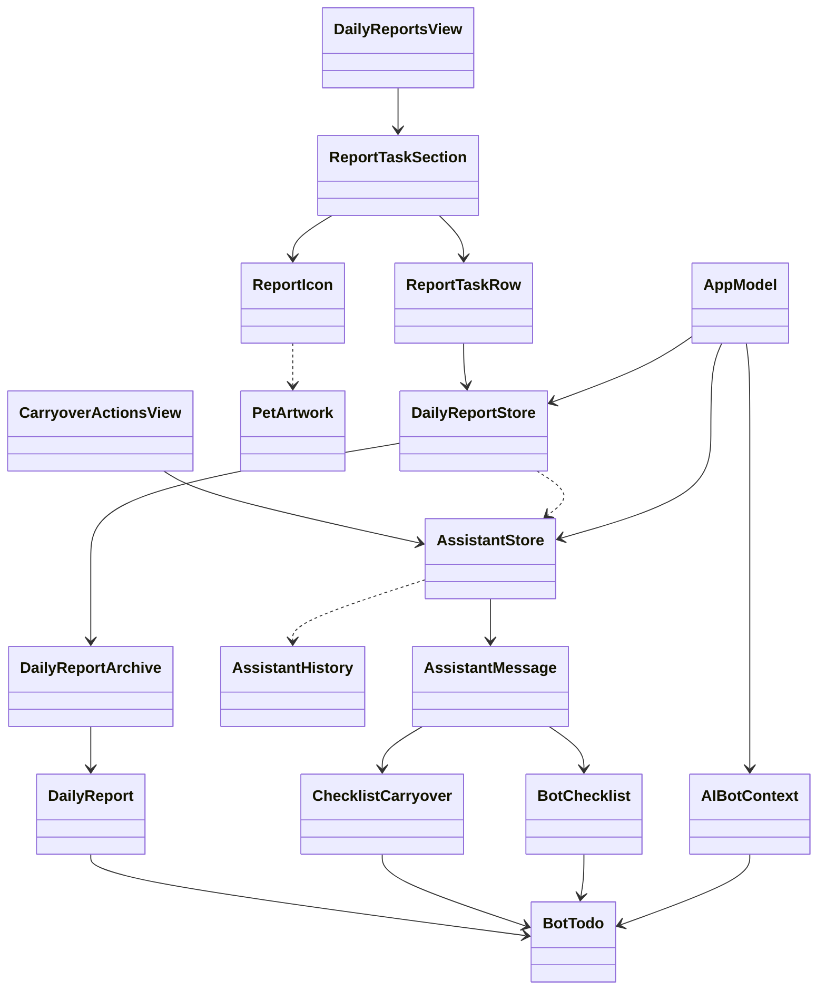
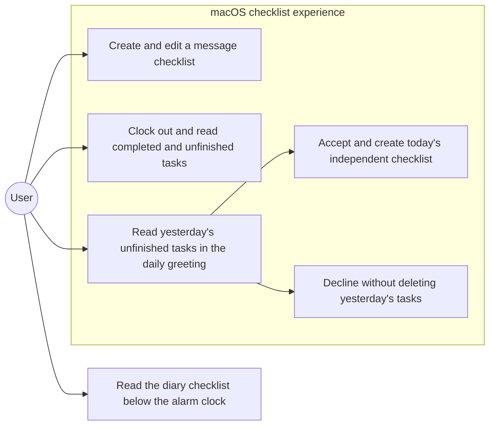
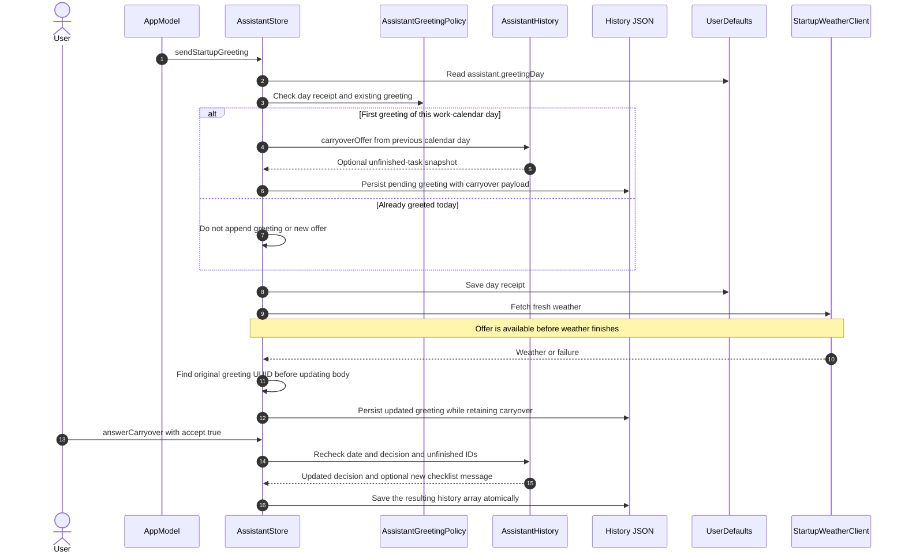
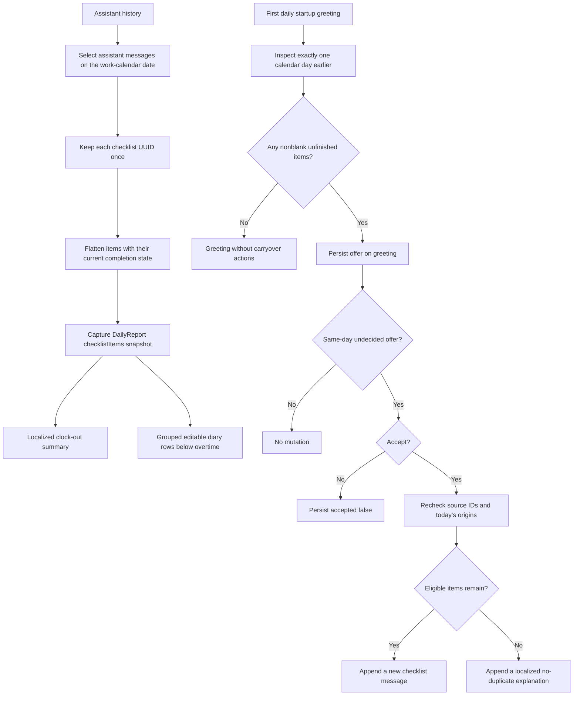
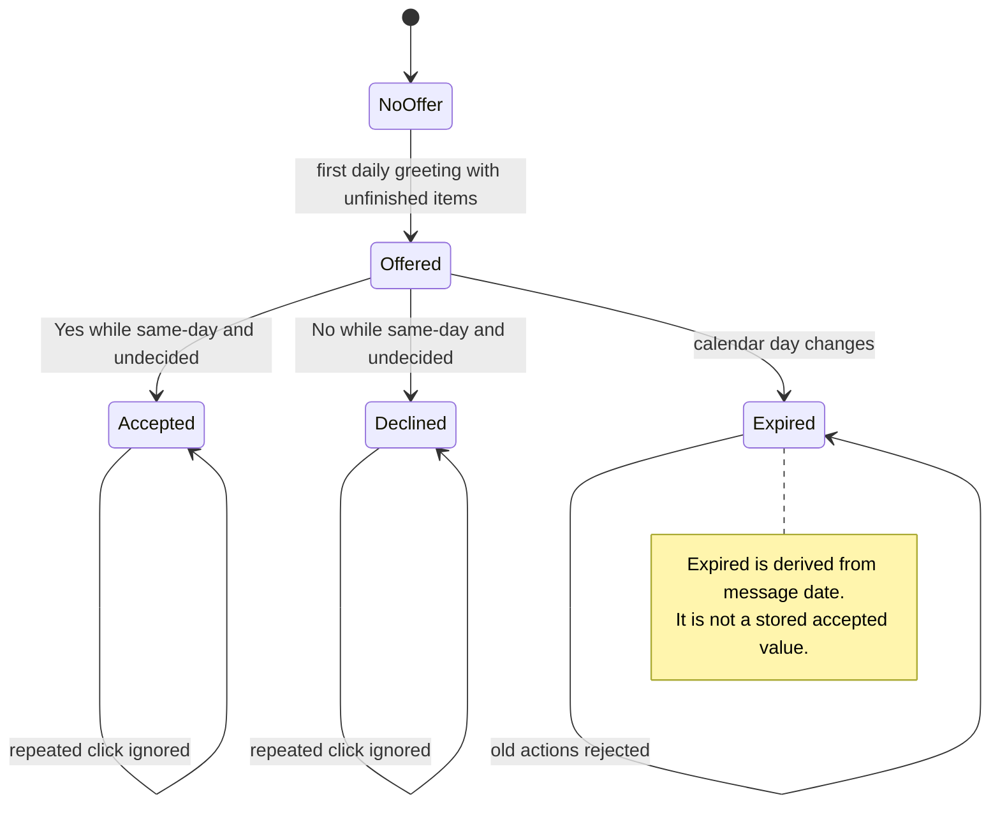
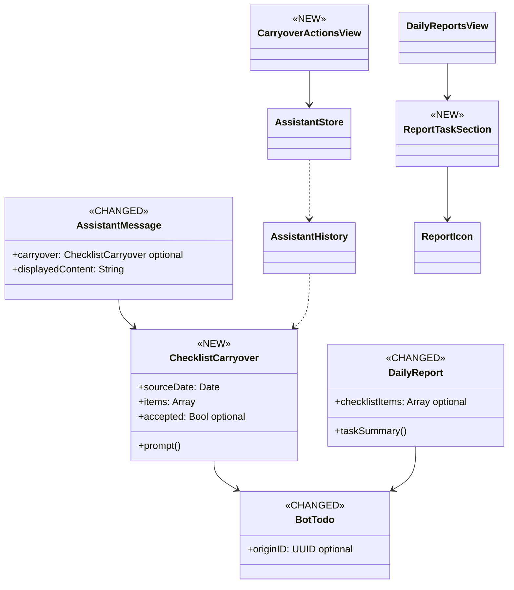
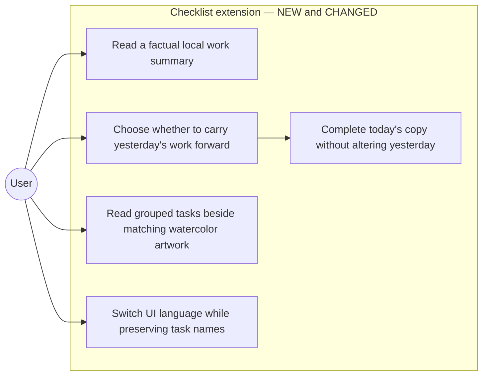
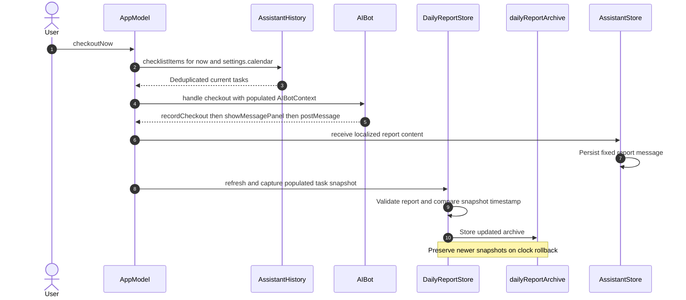
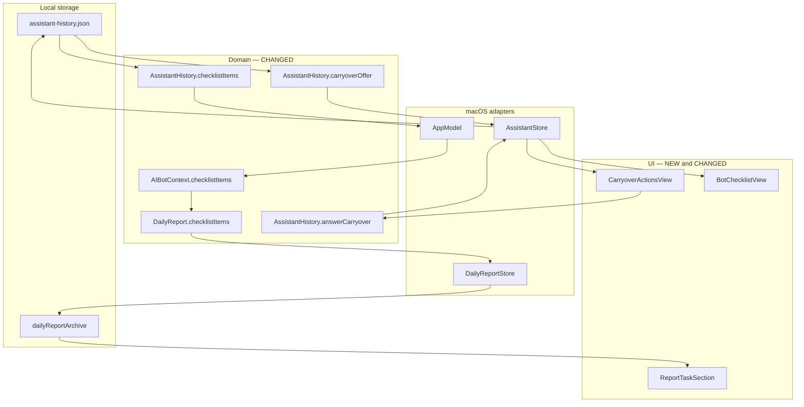
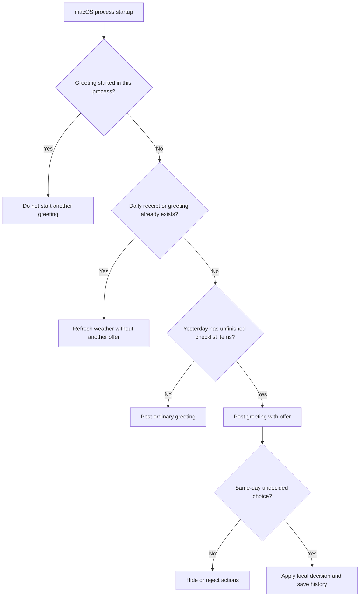

# Checklist Reports and Next-Day Carryover — Technical Specification

Status: As-built reference and maintenance contract; includes editable diary checklists  
Reviewed: 2026-10-19, Asia/Shanghai  
Source: `main` at `b8c1b12`, plus the current working-tree implementation  
Target: macOS 13+; shared domain and diary views also support iOS 16+  
Backend PR / related issue: Not supplied; no backend changes are required  
Related: [Message panel](message-panel-spec.md), [Daily reports](DAILY_REPORTS.md), [Local AIBot](LOCAL-AIBOT.md), [Localization](LOCALIZATION.md)

This document describes the implemented task summary, next-day carryover, revised diary layout and standalone hand-drawn checklist icon. Video downloading has been removed from the product. Section 2 records today's implementation; section 4 treats that same implementation as the maintenance target. Delta markers identify changes relative to the earlier diary/message-panel baseline, not additional runtime work proposed by this documentation change.

Repository adaptation: this is WorkdayBuddy, not ai-ios. Paths, `ObservableObject`, `L10n`, and existing XCTest evidence refer to this repository. The swift-testing example in §14 is explicitly proposed and is not a claim that the existing test suite was migrated. The implemented editor extension adds four swift-testing regression tests; the separate example in §14 remains a proposed compatibility test.

## Contents

1. [Scope](#1-scope)
2. [Current implementation](#2-current-implementation-as-built)
3. [Requirements](#3-requirements)
4. [Maintenance target](#4-maintenance-target-architecture)
5. [Models and compatibility](#5-models-and-compatibility)
6. [Daily aggregation](#6-daily-aggregation-and-report-snapshots)
7. [Greeting integration](#7-greeting-and-weather-integration)
8. [Carryover interaction](#8-carryover-interaction-and-identity)
9. [Diary layout and artwork](#9-diary-layout-and-artwork)
10. [Localization](#10-localization)
11. [Persistence and platform boundaries](#11-persistence-and-platform-boundaries)
12. [Removed capability and observability](#12-removed-capability-and-observability)
13. [File inventory](#13-file-inventory)
14. [Verification](#14-test-plan-and-verification)
15. [Rollout](#15-rollout-and-feature-gating)
16. [Open questions](#16-open-questions-and-ownership)

## 1. Scope

| Surface | Implemented contract |
|---|---|
| Clock-out message | Include completed and unfinished task names after the existing hydration, earnings and overtime summary |
| Diary | Water → earnings → overtime/alarm clock → checklist; show completion groups, counts and individually editable wrapping rows |
| First daily greeting | Offer yesterday's unfinished checklist items with localized Yes/No buttons |
| Acceptance | Create a separate message-owned checklist for today; preserve yesterday's list |
| Decline | Persist the decision without deleting tasks or creating a checklist |
| Artwork | Standalone transparent watercolor checklist icon matching the existing report atlas |
| Language | English and Simplified Chinese; keep task names exactly as entered |
| Removal | No video download intent, downloader, dedicated permission, installation requirement or feature documentation |

Out of scope: recurring tasks, copying deadlines or scheduled notifications, last-workday/backlog recovery, cross-device sync, a mobile chat/carryover surface, adding an LLM/tool action, changing salary calculations, and deleting historical download conversations. The removed downloader is not retained as a fallback or a gated feature.

## 2. Current Implementation (As-Built)

### 2.1 Component map

| Layer | Actual type or entry point | File |
|---|---|---|
| Checklist payload | `BotTodo`, `BotChecklist` | `Sources/WorkdayCore/LocalIntent.swift` |
| History projection | `AssistantMessage`, `AssistantHistory.checklists`, `checklistItems`, `updateChecklist` | `Sources/WorkdayCore/AssistantHistory.swift` |
| Carryover domain | `ChecklistCarryover`, `carryoverOffer`, `answerCarryover` | `Sources/WorkdayCore/ChecklistCarryover.swift` |
| Reporting | `AIBotContext`, `AIBot.handle`, `DailyReport.taskSummary` | `Sources/WorkdayCore/AIBot.swift`, `Sources/WorkdayCore/DailyReport.swift` |
| Desktop host | `AppModel.botContext`, `refresh`, `checkoutNow` | `Sources/WorkdayBuddy/App.swift` |
| Daily persistence | `DailyReportStore.capture`, `DailyReportArchive` | `Sources/SharedUI/DailyReportStore.swift`, `Sources/WorkdayCore/DailyReport.swift` |
| Greeting and interaction adapter | `AssistantStore.sendStartupGreeting`, `answerCarryover`, `persist` | `Sources/WorkdayBuddy/Services.swift` |
| Daily greeting gate | `AssistantGreetingPolicy` | `Sources/WorkdayCore/AssistantTimeline.swift` |
| Compact and expanded messages | `CarryoverActionsView`, `BotChecklistView` | `Sources/WorkdayBuddy/DesktopPetView.swift` |
| Diary renderer | `DailyReportsView`, `ReportTaskSection`, `ReportTaskRow`, `ReportIcon` | `Sources/SharedUI/DailyReportsView.swift` |
| Image loading | `PetArtwork.reportIcon` | `Sources/SharedUI/PetArtwork.swift` |
| Weather | `StartupWeatherClient`, `AIBot.startupGreeting` | `Sources/WorkdayCore/StartupWeather.swift` |
| Locale resolution | `L10n`, `AppLanguageStore` | `Sources/WorkdayCore/Localization.swift`, `Sources/SharedUI/AppLanguageView.swift` |

The shipped analogues are `BotChecklistView` for store-owned message mutation, `AssistantGreetingPolicy` for daily deduplication, and report icons 3–5 for artwork size and spacing. The existing message-panel guide remains authoritative for window, typing, SSE and scroll behavior; this feature adds payloads and renderers to that pipeline.

### 2.2 Current class diagram



### 2.3 Current use cases



### 2.4 Current sequence: first launch and acceptance



The weather completion guard checks message UUID existence; it is not a general request-generation or current-day guard. A weather request crossing midnight can still complete the earlier greeting. Checklist eligibility is independently checked at click time.

### 2.5 Current flow: summary and decision routing



### 2.6 Current state machine



### 2.7 Behaviors that constrain the design

| ID | Existing behavior and blast radius | Consequence / resolution |
|---|---|---|
| C1 | History decodes as one array; a bad required nested field can prevent the whole conversation loading. | New `originID` and `carryover` are optional. Do not assume initializer defaults repair missing required Codable fields. §5, §15, Q1. |
| C2 | Recalled checklist messages can share a checklist UUID; edits fan out to every copy. | Aggregate with `AssistantHistory.checklists`, not every message payload. New-day copies need fresh checklist and item IDs. §6, §8. |
| C3 | Daily identity includes the configured work time zone, while history messages have dates and no stored work-zone dimension. | Use the supplied calendar consistently. Changing work time zone can reclassify historical messages. §6, §15, Q2. |
| C4 | The greeting runs once per process and is suppressed by either a daily receipt or existing greeting. | No replacement offer after a same-day restart, upgrade or midnight without a new process. §7, §15, Q3. |
| C5 | History JSON and preferences are separate writes; persistence failure leaves the mutated in-memory decision intact. | Atomic JSON replacement is not a transaction across history, greeting receipt and diary. Do not promise crash-proof or write-failure-proof exactly-once behavior. §11, §15, Q1. |
| C6 | Archive schema remains version 1; new `checklistItems` is optional. | Missing means unknown legacy task history; empty means a current snapshot with no recorded tasks. §5, §9. |
| C7 | The iOS host does not provide message-owned tasks to `AIBotContext` or `capture`. | Shared UI support does not imply iOS task capture or a carryover prompt. §11, Q4. |
| C8 | Daily snapshots refresh on host ticks; task-state changes bypass the minute throttle. | A clock-out message is a fixed text snapshot; later same-day diary snapshots can reflect later task edits. §6, §11, Q5. |
| C9 | A later cloud turn can use today's `contextContent`, including displayed carryover text and checklist state. | Local execution does not guarantee these task names never enter a user-initiated cloud context. §12, Q6. |

## 3. Requirements

| ID | Testable requirement | Acceptance |
|---|---|---|
| R1 | Clock-out prose names completed and unfinished tasks and recommends continuing unfinished work tomorrow. | A1: summary receives the current deduplicated task snapshot. |
| R2 | Recalled messages do not multiply tasks in the daily snapshot. | A2: one copy per checklist UUID for that date. |
| R3 | First daily greeting offers only nonblank unfinished tasks from the previous calendar day. | A3: completed, older and future tasks are excluded. |
| R4 | Same-day undecided offers expose localized light-blue Yes/No buttons. | A4: compact and expanded views use the same store action. |
| R5 | Yes creates an independent checklist and rechecks current source state. | A5: fresh IDs; completion and deadlines reset; origin identity retained. |
| R6 | Repeated acceptance, competing offers and decline do not create duplicate tasks. | A6: existing origin IDs and the stored decision guard mutations. |
| R7 | Decisions and payloads survive successful save/load; legacy records still decode. | A7: additive fields are optional; successful persistence preserves choices. |
| R8 | Diary task rows follow the overtime/alarm-clock row and wrap long names. | A8: grouped labels, counts and a 48 pt hand-drawn icon. |
| R9 | New labels and summary templates switch between English and Simplified Chinese. | A9: task names remain user text; identities do not depend on language. |
| R10 | The product no longer implements video downloading. | A10: no download intent, executor, dependency, dedicated entitlement or related product test. |
| R11 | Diary task circles toggle completion and task names can be edited, including historical reports. | A11: persist edits, synchronize linked message checklists and preserve financial fields and task identity. |

## 4. Maintenance Target Architecture

This target preserves today's implementation. `NEW` and `CHANGED` identify the feature delta against the earlier baseline described in the linked panel/diary guides; the editor extends the existing store boundary without replacing the reporting architecture.

### 4.1 Target class diagram with delta markers



### 4.2 Target use cases



### 4.3 Target sequence: preserve report snapshot ownership



### 4.4 Target data flow and implementation chain



No task API, new server payload, telemetry backend or download service exists in this chain. The separate weather request is described in §7.

## 5. Models and Compatibility

- [x] R5, R7 / A5, A7: preserve legacy decoding and independent copied identities.

The following are selected added members in existing types, not replacement declarations:

```swift
// Sources/WorkdayCore/LocalIntent.swift (CHANGED)
// ... existing BotTodo members ...
public var originID: UUID?

// Sources/WorkdayCore/AssistantHistory.swift (CHANGED)
// ... existing AssistantMessage members ...
public var carryover: ChecklistCarryover?

// Sources/WorkdayCore/DailyReport.swift (CHANGED)
// ... existing DailyReport members ...
public var checklistItems: [BotTodo]?
```

`ChecklistCarryover` stores `sourceDate`, the offered `[BotTodo]` snapshot, and optional `accepted`: nil means undecided, true accepted, false declined. Expiry is computed from the greeting date; it is not another stored enum case.

Compatibility landmine C1: making any new field required would break older records, potentially failing the full history/diary decode rather than one row. Optional decoding preserves older records; malformed types for present fields can still fail decoding. Existing `BotTodo` fields such as `id`, `text`, `done` and `delivered` remain required despite property initializers.

Compatibility landmine C6: retain archive schema 1 because the new report field is additive. Do not synthesize task data into old reports: nil suppresses the task section; a new empty array displays the localized no-task state. Older clients may ignore and then discard new fields when saving, so downgrade is not lossless. Ship compatible readers before presenting new payloads; see §15.

No backend payload, server-driven enum, variant cache or prefix-based cache sweep is introduced. Existing strict local decoding, daily receipt keys and downgrade/resave behavior are the compatibility boundaries that apply here.

## 6. Daily Aggregation and Report Snapshots

- [x] R1, R2 / A1, A2: feed current task values through the existing reporting path.

`AssistantHistory.checklists` selects assistant messages on the supplied calendar date and keeps the first occurrence of each checklist UUID. `checklistItems` flattens their items. `updateChecklist` synchronizes edits across messages sharing that UUID, which is why recalled lists do not count twice. Deduplication is not based on text and does not merge separate checklists with identical titles.

```swift
// Sources/WorkdayBuddy/App.swift (CHANGED)
var botContext: AIBotContext {
    AIBotContext(
        now: now,
        settings: settings,
        checkout: checkoutStore.record,
        hydration: hydration,
        checklistItems: AssistantHistory.checklistItems(
            assistant.messages, on: now, calendar: settings.calendar
        )
    )
}
```

`AIBot.inspect` and the checkout branch of `handle` pass this array to `DailyReport.snapshot`. `assistantSummary` appends `taskSummary`, which handles no tasks, none completed, all completed and mixed completion states. `DailyReportStore.capture` bypasses its minute/day throttle when the current task array differs from `lastChecklistItems`.

The clock-out message contains rendered bilingual text for that moment. The diary archive contains task values from its last successful capture. Earnings and overtime freeze according to checkout policy; task state is not frozen by the same rule. A later same-day host tick can update diary tasks without rewriting an earlier clock-out message. Old-date edits do not automatically rewrite an already archived old report. Q5 records this distinction.

## 7. Greeting and Weather Integration

- [x] R3, R7 / A3, A7: attach the offer before asynchronous weather work.

`AssistantStore.sendStartupGreeting` first applies its process guard, then `AssistantGreetingPolicy.shouldPost`. That policy checks both the time-zone/date receipt in `assistant.greetingDay` and existing greeting messages. Only a newly appended greeting receives a `carryoverOffer` payload.

```swift
// Sources/WorkdayBuddy/Services.swift (CHANGED)
// Inside the existing first-greeting branch, before the weather await.
messages[messages.count - 1].greetingDay = day
messages[messages.count - 1].carryover = AssistantHistory.carryoverOffer(
    messages, now: date, calendar: calendar
)
persist()
```

The offer examines `calendar.date(byAdding: .day, value: -1, to: now)`, not 24 hours of elapsed time or the last workday. It ignores completed and whitespace-only items. The fallback calendar is `.current` if persisted settings cannot be decoded.

`AssistantMessage.displayedContent` appends the dynamically localized carryover prompt to the localized base greeting. Weather completion updates base content and weather metadata on the original UUID, leaving the carryover payload intact. This supports acceptance during a pending/failed weather request. Same-day relaunch fetches weather but adds no greeting or new offer; an already posted greeting is not retrofitted after an upgrade. Remaining open across midnight does not call this startup method again.

## 8. Carryover Interaction and Identity

- [x] R4–R6 / A4–A6: share one guarded action across both message surfaces.

`CarryoverActionsView` uses native plain Buttons with `AssistantArt.actionBlue`, a shared `Color(red: 0.43, green: 0.67, blue: 0.88)` constant. It appears in both `AssistantMessageBubble` and `ExpandedAssistantMessageView`. Actions are available while the offer is undecided and its greeting date matches `timelineDate` in `conversationCalendar`; the domain repeats the same-day check against the click's actual `now`.

`AssistantHistory.answerCarryover` executes this order:

1. Find the greeting UUID; require a payload, nil decision and a same-day greeting.
2. Store the chosen Boolean. For No, return without appending a message or changing source tasks.
3. For Yes, re-read unfinished tasks from `sourceDate`; intersect with the original offered item IDs.
4. Exclude tasks whose `originID ?? id` is already present anywhere in today's checklists, including completed items.
5. Copy current source text into fresh `BotTodo` values. Keep the original lineage in `originID`; reset `done`, `due` and `delivered` through the initializer.
6. Append a localized assistant reply with a fresh `BotChecklist` only when items remain. Otherwise append the no-duplicate/no-longer-pending explanation.
7. The store marks new replies eligible for typing and persists the resulting full history array once.

```swift
// Sources/WorkdayCore/ChecklistCarryover.swift (NEW)
// Existing copy operation inside answerCarryover.
var copy = BotTodo(text: original.text)
copy.originID = original.originID ?? original.id
```

Identity deduplication deliberately does not collapse unrelated tasks with the same text. A new-day list is independent of yesterday's checklist, so checking today's copy cannot change yesterday's saved state. A removed or newly completed source item is omitted at acceptance; newly added source items absent from the offered snapshot are not silently added. Carried tasks do not enter `LocalBotState.todos` and do not schedule notifications.

## 9. Diary Layout and Artwork

- [x] R8 / A8: preserve metric order and group task details below the alarm clock.

`DailyReportsView.reportCard` renders hydration with icon 3, earnings with icon 4, overtime with icon 5, then `ReportTaskSection` with icon 6 when `checklistItems` is non-nil. There is one divider between each metric section.

```swift
// Sources/SharedUI/DailyReportsView.swift (CHANGED)
reportRow(
    icon: 5,
    title: L10n.text("加班 ") + OvertimeCalculator.duration(report.overtimeSeconds),
    message: report.overtimeMessage
)
if let items = report.checklistItems {
    Divider().overlay(DiaryStyle.ink.opacity(0.12))
    ReportTaskSection(items: items)
}
```

`ReportTaskSection` uses a top-aligned HStack, a 48×48 pt icon, 14 pt horizontal spacing and a leading-aligned text column. The title uses the existing rounded 17 pt semibold style. Completed and unfinished groups have localized counts; task rows use actionable checkmark/circle buttons and wrapping subheadline text. The unfinished group ends with the localized tomorrow-continuation note. Clicking a task name opens an inline editor; the dense concatenated summary paragraph is not used. The diary intentionally keeps its existing light paper appearance even when the system uses dark mode.

`PetArtwork.reportIcon(6)` lazily loads and caches `Resources/PetArt/report-checklist.png`, using the existing transparent-margin trim. Indices 0–5 retain the unchanged `report-ui.png` atlas. The new standalone image was generated with the built-in imagegen tool; runtime has no generation dependency. Its full prompt and reference are recorded in [the artwork record](assets/report-checklist-prompt.md).

The generated source alpha is preserved. No atlas dimensions or coordinates change. A missing icon currently yields no image rather than an application error; resource verification must catch packaging mistakes before release. See §14 and Q7.

### 9.1 Editing and completion actions

- [x] R11 / A11: make both completed and unfinished task rows editable and persistent.

`ReportTaskRow` owns only a local draft, editing mode and focus. Clicking its text button enters the plain multiline `TextField`; Return submission or the checkmark button saves, while the x button cancels. Blank text cannot be saved. Completed task text uses strikethrough outside editing; completed items are still editable. Circle buttons toggle `done` explicitly and move the item between the two groups. The circle is disabled while its text draft is open, preventing a group move from discarding that draft. Accessibility labels and save/cancel copy use the two existing catalogs.

The write chain is `ReportTaskRow` → `DailyReportStore.editChecklistItem` → optional `onChecklistEdit` host callback → `AssistantStore.editReportChecklistItem` → `AssistantHistory.editChecklistItem`. `BotTodo.edited` trims and validates text while preserving IDs, lineage, deadlines and delivery metadata. `DailyReportArchive.editChecklistItem` changes only the selected report task; historical `updatedAt`, checkout, water, earnings and overtime remain unchanged.

The store validates and encodes a candidate archive before calling the source callback. On macOS the host finds the report date using the report's own time zone, updates the linked message task and recalled copies by stable ID, writes history successfully, then publishes it. The archive is committed only after a successful callback. A failed history write leaves both the report archive and source-message memory unchanged and exposes a localized issue; the draft remains available for retry. If the original conversation no longer contains that task, the archive can still be edited independently. A platform with no source callback edits only the archive.

This is ordered coordination, not an atomic transaction between a JSON file and UserDefaults. A process crash after the source file succeeds but before the archive write can leave them temporarily different; a later current-day capture reconciles from history. Historical chat edits do not automatically sweep old diary snapshots, and an already posted clock-out summary remains the text captured at checkout.

```swift
// Sources/SharedUI/DailyReportsView.swift (CHANGED)
ReportTaskSection(items: items) { itemID, text, done in
    store.editChecklistItem(
        reportID: report.id, itemID: itemID, text: text, done: done
    )
}
```

## 10. Localization

- [x] R9 / A9: localize app-owned templates, not task names or identity.

The catalogs are `Sources/WorkdayCore/Localization/en.json` and `Sources/WorkdayCore/Localization/zh-Hans.json`. They include the question, Yes/No, selected-choice labels, successful/no-op carryover replies, report summary branches, grouped counts and continuation text. `L10n.format` interpolates user text without treating it as another localization key.

```swift
// Sources/WorkdayCore/ChecklistCarryover.swift (NEW)
let list = items.enumerated().map {
    "\($0.offset + 1). \($0.element.text)"
}.joined(separator: "\n")
let question = L10n.format(
    "昨日有未完成的任务：\n{0}\n是否需要创建待办事项？",
    list, language: language
)
```

Carryover prompts are rendered from structured data at access time. Generated checklist replies and clock-out reports retain both language variants in `localizedContents`. Existing language observers refresh open views. Date keys, UUIDs, `originID` and stored task names do not change when the UI language changes. Only English and Simplified Chinese are supplied; Follow System resolves through the existing language policy.

## 11. Persistence and Platform Boundaries

- [x] R5, R7 / A5, A7: keep payload ownership and persistence stores explicit.

| Data | Store | Important behavior |
|---|---|---|
| Message checklists, offers, decisions and new-day lists | Application Support `OffWorkNow/assistant-history.json` | One full JSON array, ISO-8601 dates, atomic file write |
| Daily greeting receipt | UserDefaults `assistant.greetingDay` | Work time-zone ID plus local date; separate from history write |
| Diary task snapshots | UserDefaults `dailyReportArchive` | Schema 1; upsert by time-zone/date ID; reject older timestamps |
| Timed reminders and diet | UserDefaults `assistant.localBot` | Separate from message-owned checklists and carryover |
| Successful weather snapshots | UserDefaults `assistant.weatherSnapshots` | Existing limit of 365, unrelated to task correctness |

The decision and copied list are encoded in the same history write, avoiding a successfully written decision without its successfully written new list in that file. This does not cover a write failure or a crash between history and preference writes. `AssistantStore.persist` surfaces an issue but does not roll back memory. `DailyReportStore` preserves an unreadable archive instead of overwriting it; the history loader does not provide the same write-disable recovery gate.

The complete interaction is macOS-only because `AssistantStore`, `AppModel` and the chat views are desktop types. Shared domain, archive and report view changes compile for both supported platforms. `MobileModel` in `Sources/OffWorkNowIOS/IOSApp.swift` currently supplies no checklist items, so its default task array is empty. No mobile carryover surface, cross-device task sync or fresh iOS build validation is claimed by this update.

## 12. Removed Capability and Observability

- [x] R10 / A10: remove execution, not just the visible entry point.

`LocalBotIntent` now contains information, diet, diet summary, reminder, checklist and clarification cases. There is no video download case or store executor. The removed downloader and its dedicated test source no longer exist; their former filenames are intentionally not source references in this document. Download-specific strings and the Downloads-folder entitlement are absent. `Configuration/OffWorkNow.entitlements` retains only the existing sandbox, outbound network and user-selected file read/write grants.

A download-like sentence therefore follows ordinary unrecognized-text behavior: local parsing returns nil and the pre-existing cloud-chat path may run if configured. This does not execute a download. Past conversations remain ordinary historical text; no data purge or system package uninstall is part of feature removal.

No analytics events were added. Available signals are local test results, rendering checks and the store's existing `issue` message for persistence failures. Task names can appear in exported local history and in a later user-initiated same-day cloud context through `contextContent`. No cloud request is needed to aggregate, offer, accept or decline tasks.

## 13. File Inventory

The first two tables describe the implemented feature delta, including the subsequent editable-diary extension. All listed paths exist. Removed video source/test files are deliberately excluded from the existing-file inventory; §12 defines their absence contract.

### 13.1 New feature files

| File | Purpose |
|---|---|
| `Sources/WorkdayCore/ChecklistCarryover.swift` | Offer, localized prompt, decision guards and copy policy |
| `Tests/WorkdayCoreTests/ChecklistCarryoverTests.swift` | Existing five XCTest methods covering domain/report integration |
| `Tests/WorkdayCoreTests/DailyReportEditingTests.swift` | Four swift-testing regressions for identity, persistence, synchronization and invalid edits |
| `Resources/PetArt/report-checklist.png` | Standalone transparent watercolor checklist icon |
| `docs/assets/report-checklist-prompt.md` | Artwork generation provenance and full prompt |

### 13.2 Modified implementation files

| File | Change |
|---|---|
| `Sources/WorkdayCore/LocalIntent.swift` | Add optional task `originID` and validated value-preserving `edited`; retain ordinary local-intent set |
| `Sources/WorkdayCore/AssistantHistory.swift` | Optional carryover payload, localized prompt, and calendar-scoped source task editing |
| `Sources/WorkdayCore/AIBot.swift` | Add task values to context and report calls |
| `Sources/WorkdayCore/DailyReport.swift` | Optional task snapshot, summary, and validated archive-item editing |
| `Sources/WorkdayBuddy/App.swift` | Feed current-day tasks to reports and wire the report-to-history edit callback |
| `Sources/WorkdayBuddy/Services.swift` | Attach offers, handle choices, and save linked checklist edits before publishing |
| `Sources/WorkdayBuddy/DesktopPetView.swift` | Shared light-blue choice actions in compact and expanded messages |
| `Sources/SharedUI/DailyReportStore.swift` | Capture snapshots, bypass throttle on task change, and coordinate candidate edits with the source callback |
| `Sources/SharedUI/DailyReportsView.swift` | Grouped task section below overtime plus editable rows and actionable completion circles |
| `Sources/SharedUI/PetArtwork.swift` | Load/cache standalone report icon 6 |
| `Sources/WorkdayCore/Localization/en.json` | English templates and labels |
| `Sources/WorkdayCore/Localization/zh-Hans.json` | Matching Chinese templates and labels |
| `scripts/render-report-preview.swift` | Synthetic task snapshots, seven-icon check and configurable output path |
| `README.zh-CN.md` | User-facing checklist/carryover overview |

### 13.3 Documentation update files

`docs/checklist-reports-spec.md` is the new detailed specification. `docs/DAILY_REPORTS.md`, `docs/LOCAL-AIBOT.md`, `docs/AI-ASSISTANT.md`, `docs/message-panel-spec.md`, `docs/REQUIREMENTS.md` and `docs/VALIDATION.md` receive scoped updates and cross-links. `docs/assets/daily-report-checklist.png` is a documentation copy of the already inspected synthetic-data preview; no additional UI behavior is inferred from it.

## 14. Test Plan and Verification

### 14.1 Recorded evidence

The preceding implementation verification on 2026-10-19 completed **165 XCTest tests with zero failures**, built the macOS `OffWorkNow` Debug scheme, and rendered the actual SwiftUI diary with synthetic data. The subsequent editor verification also passed those 165 XCTest cases and four new swift-testing cases, and rebuilt the macOS app. Native mouse/keyboard interaction is still a manual QA item.

The editor preview harness also checked successful source synchronization, saved task edits after reload, and rejection of an archive edit when the source callback failed. Current logs are `build/editable-report-tests.log` and `build/editable-report-build.log`.

The preview harness restored 13 reports from an isolated UserDefaults suite, loaded seven report icons and confirmed unreadable archive bytes were preserved. It rendered a 720 pt page at 1.5× scale. [Inspected preview](assets/daily-report-checklist.png). Logs are retained locally at `build/checklist-cleanup-tests.log` and `build/checklist-cleanup-build.log`; build artifacts are not guaranteed to be committed or survive cleanup.

### 14.2 Complete proposed swift-testing compatibility example

This runnable example is a proposed addition to the existing test file, not an applied test or framework migration. It uses actual public APIs and the actual package module. Production tests remain in `Tests/WorkdayCoreTests/`; paths from another application's template do not apply.

```swift
// Tests/WorkdayCoreTests/ChecklistCarryoverTests.swift (CHANGED: proposed example; not applied)
import Foundation
import Testing
import WorkdayCore

@Suite("Checklist compatibility contract")
struct ChecklistCompatibilityContract {
    @Test
    func legacyReportAndAcceptedHistoryRemainReadable() throws {
        var calendar = Calendar(identifier: .gregorian)
        calendar.timeZone = try #require(TimeZone(identifier: "Asia/Shanghai"))
        let now = try #require(calendar.date(from: DateComponents(
            year: 2026, month: 10, day: 19, hour: 9
        )))
        let yesterday = try #require(calendar.date(byAdding: .day, value: -1, to: now))
        var source = AssistantMessage(role: .assistant, content: "Tasks", date: yesterday)
        source.checklist = BotChecklist(items: [BotTodo(text: "Review PR")])
        var greeting = AssistantMessage(role: .assistant, content: "Hi", date: now)
        let offer: ChecklistCarryover = try #require(AssistantHistory.carryoverOffer(
            [source], now: now, calendar: calendar
        ))
        greeting.carryover = offer
        var history = [source, greeting]
        #expect(AssistantHistory.answerCarryover(
            &history, messageID: greeting.id, accept: true, now: now, calendar: calendar
        ))
        let copied = try #require(history.last?.checklist?.items.first)
        #expect(copied.id != source.checklist?.items.first?.id)
        #expect(copied.originID == source.checklist?.items.first?.id)
        #expect(!copied.done && copied.due == nil)
        #expect(!AssistantHistory.answerCarryover(
            &history, messageID: greeting.id, accept: true, now: now, calendar: calendar
        ))

        let directory = FileManager.default.temporaryDirectory
            .appendingPathComponent(UUID().uuidString)
        defer { try? FileManager.default.removeItem(at: directory) }
        let file = directory.appendingPathComponent("history.json")
        try AssistantHistory.save(history, to: file)
        #expect(try AssistantHistory.load(from: file) == history)

        var settings = WorkSettings()
        settings.timeZoneID = "Asia/Shanghai"
        let report = DailyReport.snapshot(
            now: now, settings: settings, checkout: nil,
            hydration: HydrationSummary(cups: 0, totalML: 0)
        )
        var legacy = try #require(
            JSONSerialization.jsonObject(with: JSONEncoder().encode(report))
                as? [String: Any]
        )
        legacy.removeValue(forKey: "checklistItems")
        let restored = try JSONDecoder().decode(
            DailyReport.self,
            from: JSONSerialization.data(withJSONObject: legacy)
        )
        #expect(restored.checklistItems == nil)
        #expect(restored.taskSummary(language: .english) == nil)
    }
}
```

Documentation verification on 2026-10-19: the extracted example above type-checks against the current local `WorkdayCore` module and the installed Xcode `Testing` framework with no diagnostics. It was not executed as a test. All referenced repository paths and relative Markdown links were checked, fences were balanced, and `git diff --check` passed. The ten Mermaid diagrams were structurally reviewed; no dedicated Mermaid renderer was run.

### 14.3 Coverage matrix

| Requirements | Existing evidence | Remaining checks |
|---|---|---|
| R1–R2 | `ChecklistCarryoverTests`, `LocalIntentTests`, `DailyReportTests`: report text, current values and recalled-checklist deduplication | Diary recapture after editing a completed day's tasks |
| R3–R4 | `AssistantTimelineTests`, `ChecklistCarryoverTests`: greeting policy, previous day and language | Actual compact/expanded button clicks, startup while offline |
| R5–R6 | `ChecklistCarryoverTests`: independent IDs, repeated acceptance, competing offers, decline, source completion recheck and expired offers | Source rename/delete, empty source after offer, lineage across several days, DST |
| R7 | `ChecklistCarryoverTests`: payload round-trip, decisions and legacy report without new field | Disk-full/unwritable history, corrupt nested payload, downgrade/resave |
| R8 | Actual SwiftUI preview, long task text and seven loaded icons | Narrow windows, accessibility text sizes and real scrolling |
| R9 | `ChecklistCarryoverTests`, `LocalizationTests`: bilingual text and preserved user names | Native live switching with both message surfaces open |
| R10 | Source, tests, configuration and scripts searched for removed download symbols and dedicated entitlement | Install the new product and confirm ordinary chat cannot invoke a download |
| R11 | `DailyReportEditingTests`: archive restart, financial snapshot preservation, blank/unknown edits, recalled-list synchronization, independent copies and missing source | Native text editing and circle clicks; interrupted two-store write |

### 14.4 Manual QA

1. Use a disposable test profile. Create completed and unfinished tasks, recall the same checklist twice, clock out, and compare the message with the diary counts and names.
2. Confirm water, earnings, alarm clock and checklist order; inspect the new icon and long mixed-language wrapping. Click circles both ways, edit names with Save/Cancel, restart, and verify linked chat copies, counts and financial values.
3. Relaunch on the next configured calendar day: inspect numbered unfinished tasks, tap Yes, and verify a separate editable checklist. Repeated clicks and relaunch must not duplicate it after successful persistence.
4. Repeat with No; keep yesterday's tasks unchanged. Open an old offer after midnight and confirm its actions cannot mutate state.
5. While an offer is visible, complete/remove a source task or carry it using another offer; then accept and verify only still-eligible items are copied.
6. Switch English/Chinese with compact and expanded messages open. Verify labels and templates change, but task names, IDs and counts do not.
7. Use system dark mode: verify the intentionally light diary and the chat buttons remain readable. Check VoiceOver button labels and keyboard activation.
8. Disable networking and omit the OpenRouter API key: reports and acceptance still work; greeting weather becomes unavailable rather than blocking the offer. There is no app account/guest gate.
9. Test working-time-zone changes, DST transitions and a weekend gap. Current behavior uses the immediately previous calendar day, not the last workday.
10. Simulate an unwritable history destination, restart, and record the recovery gap rather than reporting guaranteed durability. Verify the new build has no download-specific entitlement or executor.

## 15. Rollout and Feature Gating

### 15.1 Actual gates



These are domain gates, not a feature kill switch. There is currently no client feature flag, remote experiment, server bucketing or backend ramp. Product rollback requires an application build; record export/backups should precede a downgrade that might drop optional fields. Do not invent a remote rollback mechanism in documentation.

### 15.2 Delivery order

| Phase | Required content | Compatibility reason |
|---|---|---|
| 1 | Optional payload fields and decoding coverage | Prevent a new producer from breaking legacy arrays; retain unknown-vs-empty semantics |
| 2 | Calendar-scoped projection, origin identity and domain guards | Must exist before enabling buttons or consuming snapshots |
| 3 | Host population and persistence, then shared UI/art resources and both catalogs | Prevent empty reports caused by missing host input, missing images or untranslated strings |
| 4 | macOS build, core tests, preview and native manual QA | Gate product delivery on actual evidence; retain Q1/Q4 limits |
| 5 | Any future iOS task producer or write-failure recovery | Separate scoped work; no backend prerequisite and no implied current support |

No backend payload is rolling out. For clients already installed, optional additions support reading old data; older binaries may discard new fields on resave. Existing greeting receipts also mean an update does not insert a second same-day offer. The removed downloader must remain absent in release artifacts and entitlements, not merely hidden by a gate.

## 16. Open Questions and Ownership

There is no unresolved blocking requirement for the documented behavior. The following issues constrain future promises and release acceptance; no additional implementation is silently assumed.

| ID | Question / current primary behavior | Owner | Blocking |
|---|---|---|---|
| Q1 | Should history use backup/write-disable recovery and retry or rollback after a failed decision save? Today an issue is shown, memory remains changed, and JSON plus greeting receipt are not one transaction. | macOS / Storage | No for documented behavior; Yes before guaranteeing durable exactly-once acceptance |
| Q2 | Should historical tasks preserve their original work-zone identity after settings change? Today they are reclassified by the caller's calendar. | Product + Domain | No; confirm before a time-zone-stable archive migration |
| Q3 | Should a still-running app greet after midnight, retrofit a same-day greeting after an upgrade, or recover the last working day's backlog? Today none of these occur. | Product | No; separate behavior change |
| Q4 | Should iOS capture/edit message tasks and expose the carryover prompt? Today mobile supplies the empty default task array. | Product + iOS | No for macOS; Yes before advertising mobile parity |
| Q5 | Should task status freeze at checkout? Today the chat report is fixed, while a later same-day diary capture can update task values. | Product + Domain | No; preserve this distinction until a new policy is chosen |
| Q6 | Should local tasks be excluded from later explicit cloud conversations? Today same-day context may contain them. | Product + Privacy | No; existing context policy applies |
| Q7 | Should a missing checklist image use a system-symbol fallback? Today the renderer emits no image and the resource smoke check is the release safeguard. | Design + Client | No; package the actual generated asset |
