# Message Panel — Current Implementation and Maintenance Specification

Status: As-built reference; documentation-only change  
Reviewed: 2026-10-16, Asia/Shanghai  
Source baseline: `main` at `7b375c0`, including the working-tree implementation reviewed for this document  
Target: macOS 13+, AppKit and SwiftUI; shared `WorkdayCore` also targets iOS 16+  
Backend PR / related issue: Not supplied; no first-party chat backend or server rollout is defined here  
Primary entry points: [AppDelegate](../Sources/WorkdayBuddy/App.swift#L134), [AssistantStore](../Sources/WorkdayBuddy/Services.swift#L260), [AssistantMessagesView](../Sources/WorkdayBuddy/DesktopPetView.swift#L196)

This panel is an independent AppKit child window hosting SwiftUI. `AssistantStore` owns one persisted conversation shared by the panel and Settings. Local AIBot results, scheduled reminders, checkout reports, startup weather greetings and OpenRouter replies converge on that store. SSE delivers remote text increments; a separate view animation reveals text for both local and remote messages.

The requested deliverable explains the current implementation. Section 4 therefore defines the **same architecture as the maintenance target**, with no proposed production refactor. Existing Swift excerpts are marked `UNCHANGED`; `NEW` and `CHANGED` are reserved for actual documentation changes or explicitly proposed test additions. The project uses `ObservableObject` and XCTest today; this document does not silently substitute another project's frameworks, paths or conventions.

Related guides: [AI assistant overview](AI-ASSISTANT.md), [local AIBot](LOCAL-AIBOT.md), [OpenRouter component](OPENROUTER.md), [localization](LOCALIZATION.md), [validation history](VALIDATION.md). Some older guide paragraphs describe earlier iterations, including a static greeting or an unintegrated network client. Current source and the source baseline above take precedence.

Subsequent extension (2026-10-16): local information intents now retrieve news and market data through `BotInformationClient`; see [News and markets](NEWS-MARKETS.md) for triggers, sources, data conventions and verification. The architecture diagrams below retain the reviewed baseline.

Latest feature extension (2026-10-19): [Checklist reports and next-day carryover](checklist-reports-spec.md) supersedes the checklist/report payload details for the current working tree. `AssistantMessage.carryover`, `BotTodo.originID` and `DailyReport.checklistItems` are optional additions; compact and expanded greetings now share `CarryoverActionsView`. The diagrams below retain their reviewed 2026-10-16 baseline rather than implying a new refactor. Video downloading is not a supported capability and its implementation has been removed.

## Contents

1. [Scope](#1-scope)
2. [Current implementation](#2-current-implementation-as-built)
3. [Requirements and acceptance contracts](#3-requirements-and-acceptance-contracts)
4. [Maintenance target architecture](#4-maintenance-target-architecture)
5. [Message models and persistence](#5-message-models-and-persistence)
6. [Input and local intent routing](#6-input-and-local-intent-routing)
7. [OpenRouter and same-day context](#7-openrouter-and-same-day-context)
8. [Native windows and visibility](#8-native-windows-and-visibility)
9. [Timeline and scroll coordination](#9-timeline-and-scroll-coordination)
10. [Markdown, typing and expanded messages](#10-markdown-typing-and-expanded-messages)
11. [Proactive messages, weather and checklists](#11-proactive-messages-weather-and-checklists)
12. [Localization, unread state and observability](#12-localization-unread-state-and-observability)
13. [File inventory](#13-file-inventory)
14. [Test plan and verification](#14-test-plan-and-verification)
15. [Rollout and feature gating](#15-rollout-and-feature-gating)
16. [Open questions and ownership](#16-open-questions-and-ownership)

## 1. Scope

| Area | Documented implementation |
|---|---|
| Desktop surface | Chat entry, independent window, four placements, fade, close, input and expanded-message sheet |
| Conversation | Shared store, local-first dispatch, streamed remote replies, cancellation and free-model fallback |
| History | JSON persistence, same-day default, earlier-day expansion, same-day model context, Settings history/export |
| Rich content | Markdown subset, typing presentation, per-message expansion and interactive checklist payloads |
| Proactive sources | Checkout reports, work reminders, local task reminders and daily weather greeting |
| Maintenance | Compatibility risks, reproducible checks, regression requirements and extension points |

**Out of scope:** adding new features, changing runtime behavior, replacing storage, introducing an on-device LLM, implementing image upload, tool execution, recurring reminders, server history sync, modifying salary/schedule algorithms, or claiming iOS has the macOS floating panel. No application data or credentials are needed to write or validate this document.

## 2. Current Implementation (As-Built)

### 2.1 Component map

| Layer | Actual types / responsibilities | Source |
|---|---|---|
| Application host | `AppModel`, `AppDelegate`, `DesktopPetPanel`, `FloatingAssistantChatView` | [App.swift](../Sources/WorkdayBuddy/App.swift) |
| View composition | `AssistantChatButton`, `AssistantChatView`, `AssistantMessagesView`, `AssistantMessageBubble` | [DesktopPetView.swift](../Sources/WorkdayBuddy/DesktopPetView.swift) |
| Platform adapters | `HistoryPullObserver`, `GrowingChatInput`, `ExpandedAssistantMessageView`, `BotChecklistView` | [DesktopPetView.swift](../Sources/WorkdayBuddy/DesktopPetView.swift) |
| Shared state and effects | `AssistantStore`, `AssistantCredential`, `ReminderCoordinator`, `NotificationService` | [Services.swift](../Sources/WorkdayBuddy/Services.swift) |
| Domain messages | `AssistantMessage`, `AssistantHistory`, `AssistantUsage` | [AssistantHistory.swift](../Sources/WorkdayCore/AssistantHistory.swift), [AssistantContext.swift](../Sources/WorkdayCore/AssistantContext.swift) |
| Local decisions | `AIBot`, `AIBotAction`, `AIBotMessage`, `LocalBotIntent`, `BotChecklist`, `BotTodo` | [AIBot.swift](../Sources/WorkdayCore/AIBot.swift), [LocalIntent.swift](../Sources/WorkdayCore/LocalIntent.swift) |
| Timeline and daily greeting gate | `AssistantTimeline`, `AssistantDaySection`, `AssistantGreetingPolicy` | [AssistantTimeline.swift](../Sources/WorkdayCore/AssistantTimeline.swift) |
| Transport | `OpenRouterClient`, `OpenRouterRequest`, `OpenRouterChunk`, `SSEParser` | [OpenRouterClient.swift](../Sources/WorkdayCore/OpenRouter/OpenRouterClient.swift), [OpenRouterModels.swift](../Sources/WorkdayCore/OpenRouter/OpenRouterModels.swift), [SSEParser.swift](../Sources/WorkdayCore/OpenRouter/SSEParser.swift) |
| Rendering and geometry | `MessageMarkdown`, `MarkdownMessageView`, `PetPanelLayout` | [MessageMarkdown.swift](../Sources/WorkdayCore/MessageMarkdown.swift), [MarkdownMessageView.swift](../Sources/WorkdayBuddy/MarkdownMessageView.swift), [PetPanelLayout.swift](../Sources/WorkdayCore/PetPanelLayout.swift) |
| Weather | `StartupWeatherClient`, `StartupWeather`, `AIBot.startupGreeting` | [StartupWeather.swift](../Sources/WorkdayCore/StartupWeather.swift) |
| Settings and language | `AssistantSettingsView`, `AssistantHistoryView`, `AppLanguageStore`, `L10n` | [SettingsView.swift](../Sources/WorkdayBuddy/SettingsView.swift), [AppLanguageView.swift](../Sources/SharedUI/AppLanguageView.swift), [Localization.swift](../Sources/WorkdayCore/Localization.swift) |

`AssistantHistoryView` is the closest shipped read-only analogue for consuming the same messages outside the compact panel. `ExpandedAssistantMessageView` is the analogue for displaying a single live message without replaying its typing animation. A future content renderer should follow `BotChecklistView` for mutation through the owning store and stable message ID.

### 2.2 Current class diagram

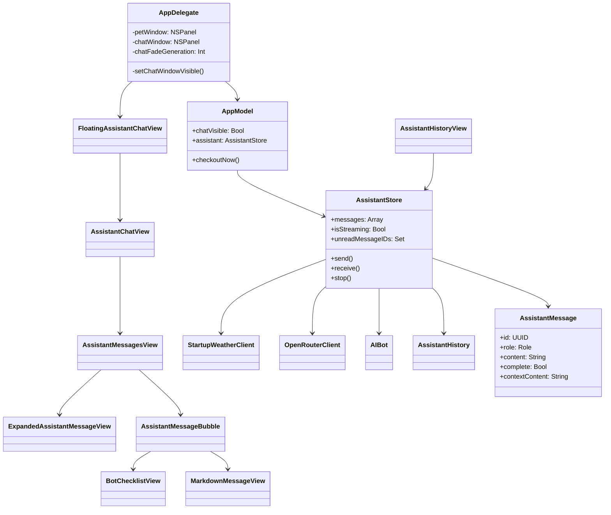

### 2.3 Current use cases

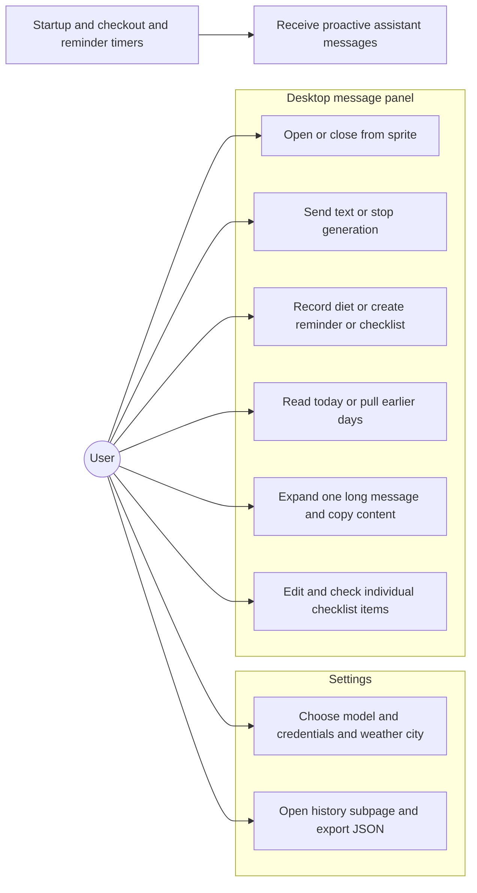

### 2.4 Current sequence: remote conversation

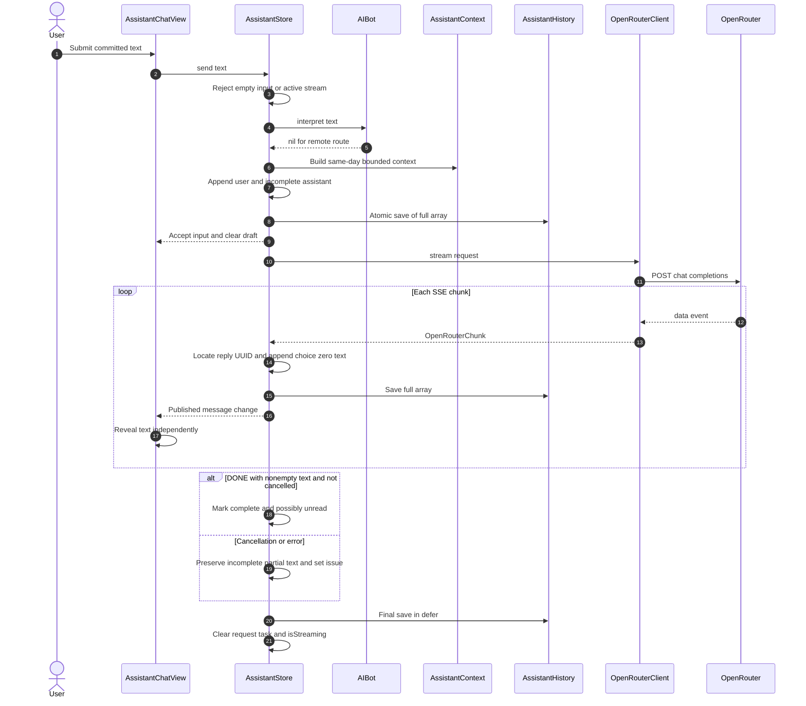

This sequence omits the bounded free-model fallback for readability; §7 defines its exact gate. The reply UUID lookup prevents applying an update to another message if the original message is no longer present. There is no general request-generation/version token for all store operations.

### 2.5 Current dispatch flow

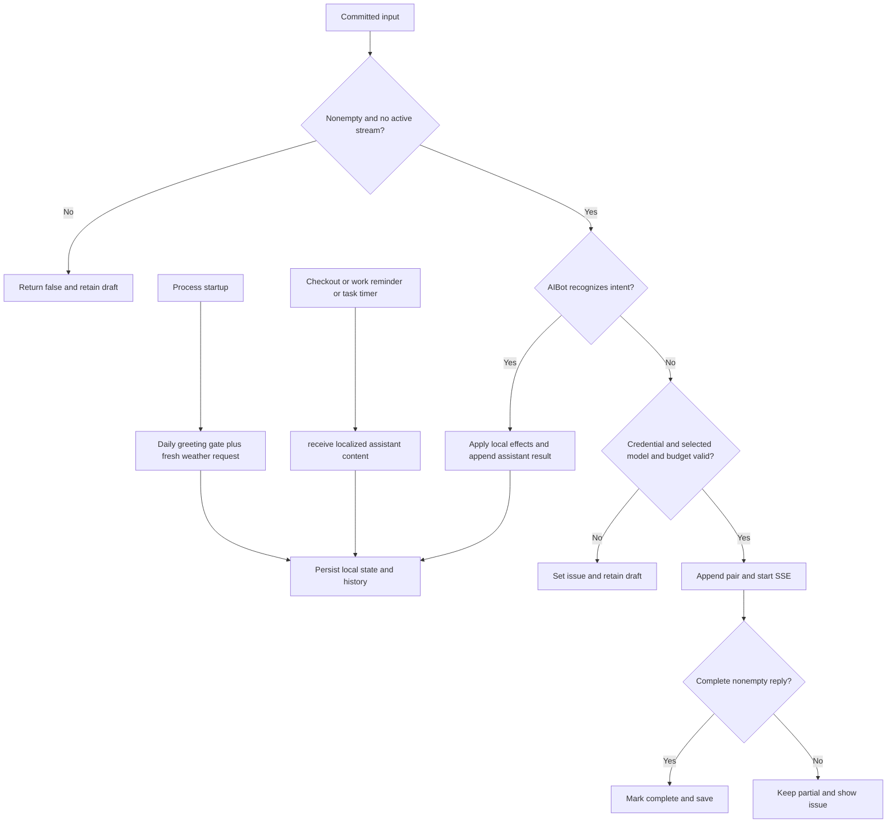

### 2.6 Current state machines

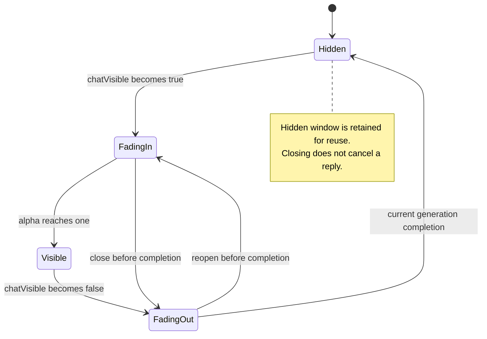

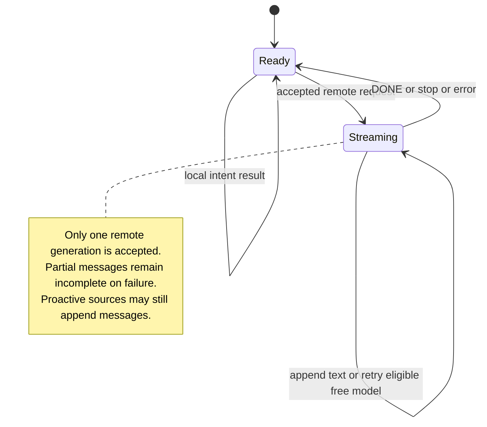

### 2.7 Behaviors that constrain maintenance

| ID | Existing behavior / blast radius | Maintenance consequence |
|---|---|---|
| C1 | One JSON array is decoded strictly. A malformed message can prevent the entire conversation from loading; later writes can replace that unreadable file. | Optional additive fields are safer than new required fields. Recovery/backup policy must precede a future schema migration. See §5 and Q1. |
| C2 | Every SSE chunk and checklist edit saves the entire history synchronously from the main actor. | Large histories can affect input, typing and streaming responsiveness. UI day paging is not disk pagination. See §5, §9 and Q2. |
| C3 | Native window frames use bottom-left coordinates; view layouts use top-left coordinates. | Keep the pet window fixed and use `chatWindowFrame` for the child; clamping moves only chat and may overlap the pet near screen edges. See §8 and Q6. |
| C4 | The timeline and model context have separate callers but share `AssistantTimeline.today`. | Loading older UI pages must never expand model context beyond today. Proactive messages count as standalone context groups. See §7 and §9. |
| C5 | Opening the panel clears all unread IDs immediately. | This is an open-panel acknowledgement, not viewport-level read receipts. Hidden older-day messages can be acknowledged without being rendered. See §12 and Q3. |
| C6 | Local intent responses and proactive data share the same history as remote replies. | A later remote conversation may include same-day diet, report, checklist or weather content. Local handling does not mean that record can never enter remote context. See §7 and Q4. |
| C7 | Optional message fields allow older records to load, but `BotTodo` has required synthesized Codable fields; no storage schema version exists. | A malformed nonoptional nested field can also fail the whole array. Preserve IDs and defaults explicitly when evolving payloads. See §5 and §15. |
| C8 | AIBot source ID/time are not passed through the common reminder/checkout `receive` call. | UI messages get fresh UUIDs and receipt times. Regular-reminder deduplication relies on the ledger, not store-level source identity. See §11 and Q5. |
| C9 | Stored content is complete while typing visibility is local view state. | Never persist displayed prefixes or build context from the animation prefix. Expanded dialogs show the full received body immediately. See §10. |
| C10 | Settings and the panel observe the same store; the store survives closing the panel. | A blank panel while Settings still updates indicates a presentation/scroll problem, not necessarily transport failure. See §9 and §14. |

## 3. Requirements and Acceptance Contracts

These are observable contracts of the reviewed implementation, with limitations explicitly retained in §16.

| ID | Requirement / acceptance criterion | Implementation | Verification |
|---|---|---|---|
| R1 | Open/close a 344×294 chat child window at any of four placements without resizing the 240×330 pet window. | §8 | `MessagePresentationTests`; native QA |
| R2 | Fade chat alpha over 0.2 seconds, or zero duration with Reduce Motion; stale close callbacks cannot hide a reopened window. | §8 | Native rapid-toggle QA; no committed window-animation test |
| R3 | Route recognized diet, reminder, checklist and clarification intents locally before credential validation. | §6 | `LocalIntentTests`; store integration QA |
| R4 | Send unrecognized text through one active SSE generation, preserve partial output on stop/failure and never silently retry a partial reply. | §7 | `OpenRouterTests`, error tests; store QA |
| R5 | Default to today's history, load one previous nonempty day per pull/action, and show one date header per older day. | §9 | `AssistantTimelineTests`; native QA |
| R6 | Restrict model history to the current work-calendar date, eligible complete groups and configured token budgets. | §7 | `AssistantTimelineTests`, `AssistantContextTests`, catalog tests |
| R7 | Render supported Markdown and typewriter animation for new assistant messages without altering stored content. | §10 | Markdown core tests; native animation QA |
| R8 | Each long message owns a bottom-right icon-only expansion action; short messages have none; expanding selects that UUID. | §10 | Native measurement/identity QA |
| R9 | Checklists live in individual messages; completed items show strikethrough, and changes persist by message/item UUID. | §11 | Serialization tests; native interaction QA |
| R10 | Request fresh real weather each launch but append a greeting only on the first launch of the local work-calendar day. | §11 | Greeting/URLProtocol tests; relaunch QA |
| R11 | Hidden-panel incoming messages set a persistent unread badge; opening clears it. | §12 | Store/native QA; detailed read receipts are not implemented |
| R12 | Local canned content supports English and Simplified Chinese; user text and remote output are not retroactively translated. | §12 | `LocalizationTests`; runtime language QA |
| R13 | Expose all raw stored messages and JSON export in a separate Settings history page. | §5 and §12 | History round-trip tests; Settings navigation QA |
| R14 | Persist optional rich payloads compatibly and retain interruption state across relaunch. | §5 | History/timeline/weather tests; host migration QA |

## 4. Maintenance Target Architecture

There is **no runtime delta** in this deliverable. The following target diagrams restate the boundaries that future changes must preserve, rather than claiming an unapproved refactor is implemented. `Existing` means retained as built.

### 4.1 Target class diagram

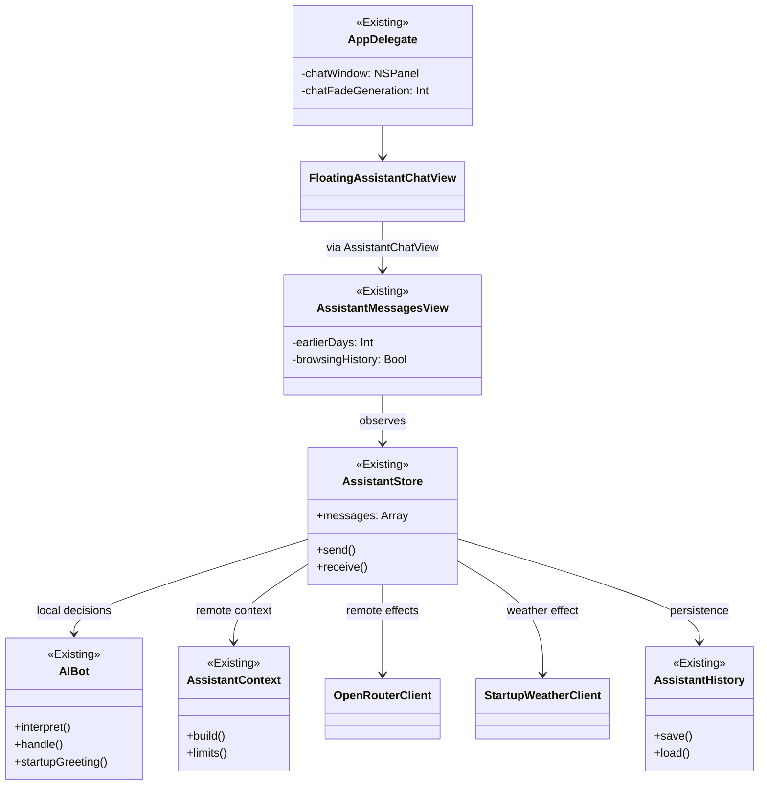

### 4.2 Target use cases

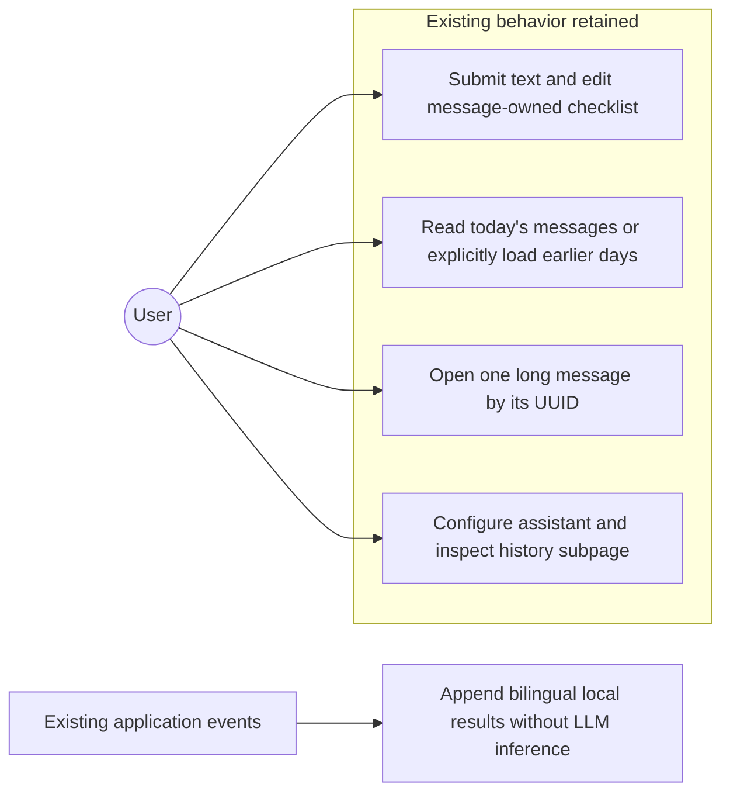

### 4.3 Target sequence: retain local-first dispatch

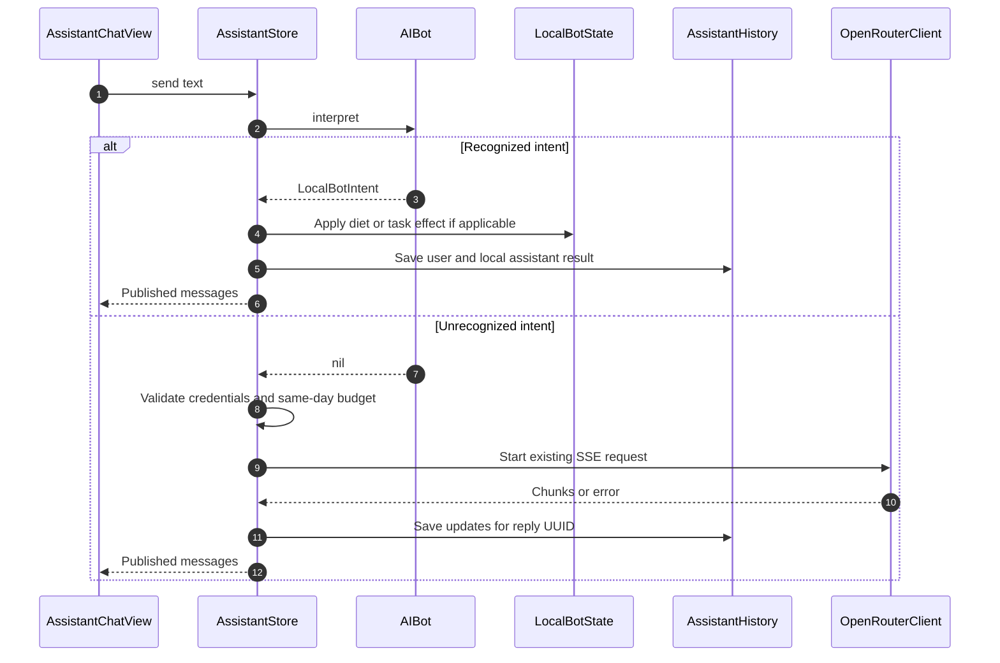

### 4.4 Target dispatch flow

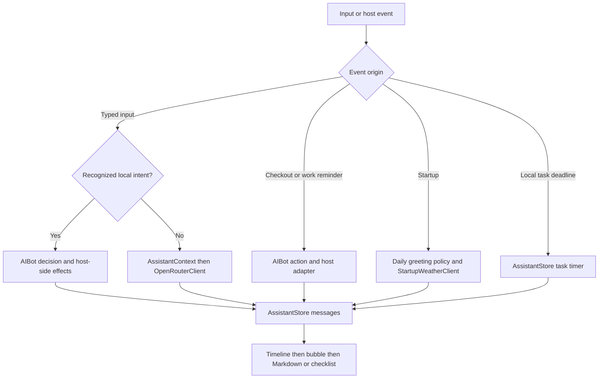

### 4.5 Target data flow and identity boundaries

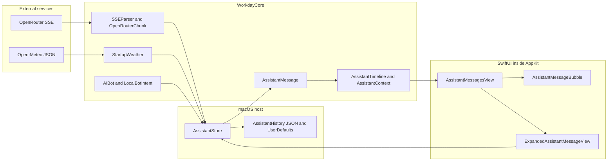

The diagram shows logical module boundaries: `AssistantHistory` is implemented in `WorkdayCore` but executes host-requested disk effects; it is grouped beside host persistence here to distinguish effects from pure policy.

## 5. Message Models and Persistence

Requirements: R13, R14; constraints: C1, C2, C7.

### 5.1 Stored message contract

`AssistantMessage` is Codable, Identifiable, Equatable and Sendable. Its required fields are `id`, `date`, `role`, `content`, and `complete`. Optional fields are `usage`, `modelID`, `proactive`, `greetingDay`, `checklist`, `weather`, `weatherFailure`, and `localizedContents`.

The role enum supports only `user` and `assistant`. There is no persisted content-type enum: optional payloads add weather/checklist capabilities to a normal message. A newly unknown role or a malformed typed field is not tolerated per item.

- `displayedContent` selects `localizedContents` using the resolved App language, falling back to `content`.
- `contextContent` appends the current checklist as Markdown `- [x]` / `- [ ]` rows. This is used by model context, Settings history and Copy All.
- `isStartupGreeting` accepts an explicit day marker, weather metadata or legacy greeting text, but requires an assistant proactive message.
- `AssistantMessage.date` is fixed at creation; a streamed reply is grouped by its start time even if completion crosses midnight.

```swift
// Sources/WorkdayCore/AssistantHistory.swift (UNCHANGED: as-built excerpt)
    public var contextContent: String {
        guard let checklist else { return displayedContent }
        return displayedContent + "\n" + checklist.items.map { "- [" + ($0.done ? "x" : " ") + "] " + $0.text }.joined(separator: "\n")
    }
```

### 5.2 Storage map

| Store | Actual key or location | Contents / write timing |
|---|---|---|
| History file | Application Support plus `OffWorkNow/assistant-history.json` | Entire array; ISO8601 dates; atomic write on receive, chunk, checklist edit and completion |
| Unread preference | `assistant.unreadMessages` | UUID string array; reconciled against loaded messages |
| Assistant preferences | `assistant.model`, `assistant.owner`, `assistant.models` | Selected model, owner name and cached catalog |
| Budgets | `assistant.inputTokenBudget`, `assistant.outputTokenLimit` | Normalized configured options |
| Credential | `assistant.apiKey` | Local UserDefaults string; no Keychain access and no encryption by this implementation |
| Local automation | `assistant.localBot` | Codable `LocalBotState` with task reminders and diet entries |
| Greeting gate | `assistant.greetingDay` | Time-zone identifier plus local date key |
| Weather | `assistant.weatherCity`, `assistant.weatherSnapshots`, `assistant.latestWeatherFailure` | City, latest 365 successful snapshots, latest failure text |

The Application Support URL comes from `FileManager`; sandboxed builds resolve within their app container. Do not hard-code the unsandboxed `~/Library/Application Support` path in another adapter.

`AssistantHistory.save` creates the containing directory and uses pretty-printed, sorted-key JSON with `.atomic`. Atomic replacement reduces partial-file writes; it does not provide per-message recovery, encryption, cross-store transactions or multi-process coordination.

### 5.3 Decode and migration landmines

1. Missing optional payload fields are compatible with legacy history. Existing tests cover this.
2. Invalid JSON, unknown required role, invalid date or malformed nested rich content fails the complete array decode. `AssistantStore.init` sets `issue` and continues with an empty in-memory array. A subsequent startup greeting or send can overwrite the original file; no automatic backup or write lock exists. **Blast radius: the whole visible/exportable history, not one bad bubble.** Q1 tracks the decision before a future schema change.
3. Checklist migration runs only when no loaded message already has a checklist. It locates the latest legacy checklist acknowledgement, attaches undated global todos to that message, removes those todos from `LocalBotState`, and persists both stores. There is no transaction between them.
4. A greeting interrupted while `weatherFailure == "pending"` is converted in memory to complete/unavailable with `"interrupted"`. Initialization does not independently flush that repair immediately; a later persistence call writes it.
5. `receive` does not deduplicate an AIBot source ID; message UUIDs are generated anew. Host reminder reservation is therefore part of correctness.

### 5.4 Settings history and export

`AssistantSettingsView` uses `NavigationStack`; its primary Form contains only a history link and raw message count. `AssistantHistoryView` reads the same `AssistantStore.messages` and renders all raw stored records using `contextContent`, including incomplete replies and legacy duplicates. The compact panel's day/greeting filters do not modify this data source.

`NSSavePanel` defaults to `pet-chat-history.json`; `store.export(to:)` uses the same history serializer. The export contains messages and optional payloads, not `assistant.apiKey`. Exported local content may still be sensitive to the user.

Acceptance: loading an older JSON file without rich payloads must work; export/reload must preserve UUIDs, Unicode, completion state and checklist values. Corrupt-file recovery is a known implementation gap, not a fulfilled guarantee.

## 6. Input and Local Intent Routing

Requirements: R3, R4; constraint: C6.

### 6.1 Native text input and send control

`GrowingChatInput` bridges `NSScrollView` and a plain `NSTextView`. The text view owns its native buffer while the user types. `Coordinator.publishCommittedText` avoids publishing marked IME text. `updateNSView` skips replacement while marked text exists and only applies external changes that differ from the last committed buffer.

Return and keypad Enter send only when Shift is absent and no marked text is active. Shift+Return falls through to native editing. `unmarkText` schedules a committed-buffer publication on the next main-queue turn.

The input height estimate uses a 14-point font and a 235-point measuring width, clamped to 22–88 points before padding. At the maximum, the native scroll view handles additional lines. The measuring width is fixed, not measured from the current input control.

`AssistantChatView.send` clears the draft only if `AssistantStore.send` returns true. The send control is disabled for an empty nonstreaming draft, sends nonempty drafts, and becomes Stop while streaming. Closing chat is a separate action and never calls Stop.

### 6.2 Local-first branch

```swift
// Sources/WorkdayBuddy/Services.swift (UNCHANGED: as-built excerpt)
    func send(_ text: String) -> Bool {
        let text = text.trimmingCharacters(in: .whitespacesAndNewlines)
        guard !text.isEmpty, !isStreaming else { return false }
        if let intent = localBot.interpret(text, now: Date(), calendar: botCalendar) {
            issue = nil; handleLocal(intent, input: text); return true
        }
        guard let key = AssistantCredential.read(), !key.isEmpty else { issue = "请先在 AI 助手设置中保存 OpenRouter API Key。"; return false }
        guard !modelID.trimmingCharacters(in: .whitespacesAndNewlines).isEmpty else { issue = "请先设置模型 ID。"; return false }
        guard let model = selectedModel else { issue = "请先在 AI 助手设置中选择可用模型。"; return false }
```

`AIBot.interpret` is deterministic regex parsing, not an embedded LLM. It returns `nil` only for the cloud route. Supported branches are:

| Intent | Examples | Actual side effect |
|---|---|---|
| Checklist | `帮我建一个 todo list`, `帮我建一个 checklist`, `today todo`, explicit delimited entries | Append user and assistant acknowledgement; attach a fresh `BotChecklist` |
| Reminder | `提醒我14:00创建 App Connect 新版本`, `提醒我明天下午4点回归测试`, English 24-hour times | Save timed `BotTodo`; schedule system notification; confirm in chat |
| Clarification | Missing/invalid reminder time or a time already passed | Append local clarification; no model call |
| Diet record | `我今天吃了鸡蛋，喝了牛奶`, `I ate eggs` | Store original text with a date; confirm daily entry count |
| Diet summary | `统计今天的饮食`, supported English summary expressions | List that day's original entries and count; no nutrient inference |

Checklist routing is evaluated before reminders and diet rules. Chinese time parsing supports today/tomorrow/day-after, optional morning/afternoon/evening and colon or `点` notation. English reminder parsing supports today/tomorrow and `HH:mm`. Arbitrary natural-language scheduling is not implemented.

An active cloud stream blocks new local commands too, because the stream guard precedes intent detection. AIBot itself performs no disk, AppKit, notification or network effects; `AssistantStore.handleLocal` applies them.

## 7. OpenRouter and Same-Day Context

Requirements: R4, R6; constraints: C2, C4, C6.

### 7.1 Context construction

`AssistantContext.build` first reserves the system/current-input budget, then filters history through `AssistantTimeline.today` using the supplied work calendar and a fresh default `Date()`.

It collects at most six eligible **groups**, not always six full user/assistant turns. A complete proactive assistant record is one standalone group. An ordinary complete assistant reply requires an immediately preceding complete user message. Incomplete, empty and moderation/embedding/reranking model replies are excluded. All records on previous or future local calendar dates are excluded; later times within the same date are not independently filtered by clock time.

```swift
// Sources/WorkdayCore/AssistantContext.swift (UNCHANGED: as-built excerpt)
        let history = AssistantTimeline.today(history, now: now, calendar: calendar)
        var pairs: [[AssistantMessage]] = []
        for index in history.indices where history[index].role == .assistant && history[index].complete && !history[index].content.isEmpty && isConversationModel(history[index].modelID) {
            if history[index].proactive == true { pairs.append([history[index]]); continue }
            guard index > 0, history[index - 1].role == .user, history[index - 1].complete else { continue }
            pairs.append([history[index - 1], history[index]])
        }
        var selected: [AssistantMessage] = []
        for pair in pairs.reversed().prefix(maximumHistoryMessages / 2) {
            let cost = pair.reduce(0) { $0 + estimatedTokens($1.contextContent) }
            guard cost <= remaining else { break }
            remaining -= cost; selected.insert(contentsOf: pair, at: 0)
        }
        return [OpenRouterMessage(role: .system, content: system)] + selected.map {
            OpenRouterMessage(role: $0.role == .user ? .user : .assistant, content: $0.contextContent)
        } + [OpenRouterMessage(role: .user, content: current)]
```

Groups are considered newest first. If the next group's UTF-8 byte cost plus 24 bytes per message exceeds the remaining budget, selection stops rather than skipping it to search older smaller groups. Whole groups are retained, preserving chronological order. `contextContent` supplies current checklist state; the typing prefix is never used.

The UI may display older days while this function still sends only today. Local diet and other proactive messages are eligible for later remote requests; see Q4. Local command responses are marked proactive by the current shared `receive` method, so their triggering user message need not be included as a paired context group.

### 7.2 Limits and model metadata

Defaults are 4,096 input-budget units and 1,024 output tokens; app maxima are 131,072 and 16,384. `limits` respects the smaller model/provider context limit, reserves 512 units, keeps a baseline input allowance and clamps output to model/provider and configured limits. These input units conservatively estimate tokens from UTF-8 bytes; they are not a tokenizer count.

Model refresh is `GET https://openrouter.ai/api/v1/models`, with a 20-second timeout and cached metadata fallback on error. Only allowlisted text-capable models within source-defined price/capacity limits are accepted. Refresh never silently changes the selected model ID. The bundled catalog is a dated source snapshot, not a guarantee that a provider remains free or available.

Optional reasoning is disabled only when metadata explicitly says it can be disabled. The App sends text only even when Settings labels a model as vision-capable. The low-level model supports richer JSON, but this chat input has no image upload or tool executor.

### 7.3 SSE request and decode contract

The client defaults to POST `https://openrouter.ai/api/v1/chat/completions`, Bearer authentication, JSON content type, SSE Accept, `X-OpenRouter-Title: WorkdayBuddy`, a 120-second timeout, and a 1 MiB event limit. Each stream owns an ephemeral URLSession. `OpenRouterRequest` forces `stream = true`; additional parameters cannot override core request fields.

`SSEParser` processes bytes, permits BOM and CR/LF/CRLF line endings, ignores heartbeat comments and joins multiple `data:` lines with a newline. Only `[DONE]` ends a stream successfully. EOF after a `finish_reason` without `[DONE]` still throws `incompleteStream`; an unterminated last event is not flushed at EOF.

The store consumes only choice index zero's `delta.content`. Reasoning, tool-call fields, finish reasons and raw extras are available in the protocol model but are not rendered/executed by the panel. An event with unknown extra fields can survive, while an incompatible type for a required typed field can fail event decoding.

### 7.4 Completion, cancellation and fallback

| Event | Store behavior |
|---|---|
| Nonempty remote request accepted | Append user and empty assistant; mark assistant incomplete; register typing ID; persist |
| Text chunk | Find reply UUID, append choice-zero text, update model ID/valid usage and persist full history |
| `[DONE]` with nonempty text, not cancelled | Mark complete, clear issue; mark unread if panel is hidden |
| `[DONE]` without text | Keep incomplete and show no-text issue |
| Stop / cancellation | Cancel request Task; retain text and incomplete state; show stopped issue |
| Network / protocol / API error | Retain partial record and incomplete state; show issue |
| Any end path | `defer` clears `isStreaming` and task reference and persists |

Transport termination cancels its producing Task and invalidates the session. The store checks cancellation both while consuming and after the loop, because cancellation may terminate an async sequence without throwing. There is no reconnect, Last-Event-ID resume or partial-answer retry.

Only an initial free-model attempt that has received no text may fall back once. Eligible errors are HTTP 429/502/503 or top-level API error code 429. Another allowlisted free model is selected, preferring a different provider. Context, output limits and reasoning parameters are rebuilt; the selected Settings model remains unchanged and no paid fallback is used. The initial history/calendar snapshot is retained, but the second context build gets a fresh current time; a cross-midnight fallback may therefore select a different local day.

A `[DONE]` stream with nonempty text is marked complete even when the recorded finish reason is `length` or a content-filter reason. Completion currently represents transport/app acceptance, not a semantic guarantee that the requested answer is exhaustive.

## 8. Native Windows and Visibility

Requirements: R1, R2; constraint: C3.

### 8.1 Ownership and coordinate mapping

`AppModel.chatVisible` is the logical visibility source. Its setter immediately calls `assistant.setPanelVisible`. `AppDelegate` observes the property and schedules native work on the main queue; it discards an event if the model no longer matches that event's value.

The pet and chat are separate `DesktopPetPanel` instances with borderless/nonactivating styles, transparent backgrounds, no native shadow, join-all-spaces/full-screen-auxiliary behavior, and ability to become key but not main. SwiftUI draws the paper shape and its own shadow. Chat is added as a child above the pet. The message panel has no title copy; the close control remains.

`PetPanelLayout.petSize` is 240×330, `chatSize` is 344×294, with an 8-point preferred gap. `chatWindowFrame` maps SwiftUI top-origin geometry into AppKit screen coordinates. It clamps only chat to `pet.screen?.visibleFrame`; it never changes the supplied pet frame. Near edges, the chosen side may overlap the pet after clamping; automatic side flipping is not implemented.

`windowDidMove` repositions chat after pet movement, and store/settings observations update its placement/level. The older combined-canvas `PetPanelLayout.init` and `windowFrame` helpers remain for geometry and restoration compatibility, but opening chat no longer resizes the pet window.

### 8.2 Fade and stale-close guard

```swift
// Sources/WorkdayBuddy/App.swift (UNCHANGED: as-built excerpt)
        } else if let chat = chatWindow {
            chat.ignoresMouseEvents = true
            NSAnimationContext.runAnimationGroup({ context in
                context.duration = NSWorkspace.shared.accessibilityDisplayShouldReduceMotion ? 0 : 0.2
                chat.animator().alphaValue = 0
            }, completionHandler: { [weak self, weak chat] in
                Task { @MainActor in
                    guard let self, let chat, self.chatFadeGeneration == generation, !self.model.chatVisible else { return }
                    chat.orderOut(nil); chat.parent?.removeChildWindow(chat)
                    self.syncPetWindow()
                }
            })
        }
```

On open, the host ensures the pet exists, creates or reuses chat, computes its frame, sets alpha to zero only when it was hidden, enables mouse events, attaches the child, orders it front and animates alpha to one. On close it immediately disables mouse events and animates alpha to zero. Only the current `chatFadeGeneration` completion may order it out and detach it.

Reduce Motion changes the native fade duration to zero. The retained chat window and store continue to exist after close. `chatVisible` changes read/typing policy immediately, slightly before the visual fade completes.

Acceptance: rapid open-close-open must not execute an old close completion against the new open window; no pet position/size change is caused by chat visibility in any placement. Screen-edge/multimonitor behavior still needs native QA.

## 9. Timeline and Scroll Coordination

Requirements: R5; constraints: C2, C4, C10.

### 9.1 Day selection is an in-memory projection

`AssistantStore` loads the entire history once. `AssistantTimeline.sections` groups it by the start of each message's day using the work calendar, excludes future calendar dates, selects today plus the requested number of previous **nonempty** days, sorts days/messages chronologically, and hides duplicate startup greetings within each section. Raw storage remains unchanged.

`earlierDays = 0` is the default. Each action increases it by one, not one message page. Older sections have a date header once before their first message; today's section has no date header. With no messages today, the empty-state copy and earlier-history action can both appear. A one-second store timer updates the calendar/day reference when the day or saved time zone changes.

The primary panel deliberately uses eager `VStack` for accurate measured message heights during typing and streaming. Settings history separately uses `LazyVStack` without this follow-scroll path. Day expansion does not reduce the number of records decoded or held in memory.

### 9.2 Pulling history and retaining the reading position

A button is the keyboard-accessible load action. `HistoryPullObserver.PullView` also finds the enclosing native scroll view, allows vertical elasticity, listens to clip-view bounds changes, and triggers a pull when `bounds.minY < -40`. Its latch resets at nonnegative bounds and its token is removed when detached/deinitialized.

`loadEarlier` captures the previous first displayed message UUID, marks browsing/loading state, increases the day count, waits 32 ms and restores that UUID to the top without animation. If today was empty, it falls back to the latest anchor. This preserves the previous reading anchor; it does not automatically place the first newly loaded old message at the top.

While `browsingHistory` is true, incoming replies do not force a bottom jump. Back to Today, panel reopen or work-calendar day changes reset earlier days and resume following. Manually scrolling up **within today's messages** does not set `browsingHistory`; stream/typing updates may still pull the viewport down. Q7 records that distinction.

### 9.3 Bottom-follow scheduling

Three observations request bottom following: content height, message ID list and last message content. Bubble typing also requests it. Calls are coalesced by a pending Task and delayed 16 ms; the Task increments `bottomScrollRequest` rather than directly scrolling during layout.

`HistoryPullObserver` detects a new request or transition back to following. It applies native document-bottom coordinates on the next main-queue turn, plus a 100 ms reapplication if that request has not been superseded. Every execution rechecks `followLatest`; old-history browsing and hiding disable it. This compensates for native/SwiftUI offset restoration after a day-section rebuild.

The panel cancels its Task on hide/disappear. These timing constants and native clip-view assumptions are implementation details requiring regression checks on supported macOS versions, not protocol guarantees.

## 10. Markdown, Typing and Expanded Messages

Requirements: R7, R8; constraint: C9.

### 10.1 Supported Markdown subset

`MessageMarkdown.blocks` is a custom line parser. Stable block IDs are starting source-line indices, so streamed growth tends to preserve earlier block identities. It supports paragraphs with preserved line breaks, ATX headings, ordered/unordered list items with limited indentation, quote groups, fenced code, pipe tables and horizontal rules.

`MarkdownMessageView` builds native SwiftUI content for each block. Inline styling uses `AttributedString` with `.inlineOnlyPreservingWhitespace`; inline code receives a monospaced font. Code blocks and tables scroll horizontally; table cells have a fixed 120-point width. An unfinished fence is displayed as literal code rather than dropped.

Markdown `[x]` items become static glyphs. They are **not** `BotChecklist` and do not mutate tasks. The parser is not a complete CommonMark/GFM engine, does not execute code/HTML, and does not fetch embedded images. Rich input arrays/tool calls supported by the low-level protocol are not a panel feature.

### 10.2 Typewriter behavior is not SSE

`AssistantStore.unpresentedReplyIDs` is in-memory presentation bookkeeping. New assistant results register their UUID. A bubble consumes that registration when first presented. On relaunch only persisted unread UUIDs repopulate it; typing progress itself is not saved.

For a new assistant message, the bubble displays a prefix of the complete current `displayedContent`. Its cancellable `.task` is keyed by the content plus visible/hidden state. Every 20 ms it increases `revealedCount` by `max(1, remaining / 50)`, catching up faster to large chunks. If replacement content no longer extends the preceding source, it resets the reveal count. User messages, Reduce Motion, previously presented records and language changes display the full text.

SSE can append the stored body faster than it is visually revealed. Local messages arrive as a complete body but use the same prefix animation. Closing cancels presentation work via visibility while the network request remains active.

### 10.3 Per-message long-content expansion

The list's `GeometryReader` passes the actual message viewport height into each bubble. A second measurement captures the rendered content **excluding the expansion footer**. The footer appears only when `viewportHeight > 0` and `contentHeight + 20 > viewportHeight`, where 20 accounts for vertical bubble padding.

```swift
// Sources/WorkdayBuddy/DesktopPetView.swift (UNCHANGED: as-built excerpt)
                }.background(GeometryReader { geometry in
                    Color.clear.onAppear { contentHeight = geometry.size.height }
                        .onChange(of: geometry.size.height) { contentHeight = $0 }
                })
                if viewportHeight > 0, contentHeight + 20 > viewportHeight {
                    HStack {
                        Spacer()
                        Button(action: expand) {
                            Image(systemName: "arrow.up.left.and.arrow.down.right")
                                .font(.system(size: 12, weight: .semibold))
                                .frame(width: 28, height: 28)
                                .background(AssistantArt.paper, in: Circle())
                                .overlay(Circle().stroke(AssistantArt.ink.opacity(0.35), lineWidth: 1))
                        }.buttonStyle(.plain).help(L10n.text("查看完整消息"))
                            .accessibilityLabel(L10n.text("查看完整消息"))
                    }
                }
```

Each long bubble owns its own bottom-right, 28×28 icon action. It has localized help/accessibility text but no visible “Expand” label. There is no fixed panel overlay. The footer follows that message when scrolling and may be offscreen while reading the middle of a very long message. As typing reveals more lines, the measurement and button eligibility update.

The action assigns that message to `expandedMessage`; `.sheet(item:)` uses its UUID. `ExpandedAssistantMessageView` looks the UUID up in the observed store, so new SSE text and checklist edits continue updating the dialog. It renders the full received body without prefix animation, supports text selection, Copy All of `contextContent`, and Close/Escape. Maximum intended dimensions are 680×600, limited by the main screen's visible area minus margins; the implementation uses `NSScreen.main`, not necessarily the chat window's monitor.

Acceptance: two long messages must open their own UUIDs independently; a short message must not get the action; adding a large checklist can also qualify the owning message. Opening a sheet must not start another model request.

## 11. Proactive Messages, Weather and Checklists

Requirements: R3, R9, R10; constraints: C6, C8.

### 11.1 Source matrix

| Producer | Entry into messages | Opens the panel? | Remote dependency |
|---|---|---|---|
| User local intent | `handleLocal` appends user then uses `receive` | Already submitting from panel | None for classification/local reply; system notification effects are separate |
| User cloud request | `send` creates pair and stream task | Already submitting from panel | OpenRouter |
| Clock-out | `AppModel.checkoutNow` executes ordered AIBot actions | Yes, before posting report | None |
| Hourly/offwork/overtime reminder | `ReminderCoordinator.onMessage` calls `receive` after ledger reservation | No | None |
| Local task deadline | One-second `deliverLocalReminders` marks delivered then calls `receive` | No | None for chat; system notification is also scheduled |
| Startup greeting | `sendStartupGreeting` appends a pending greeting then updates the same UUID | No | Open-Meteo; no LLM |

`AIBotEvent.startup` concerns regular-reminder startup policy and is distinct from `sendStartupGreeting`. The latter is called once per `AppModel` initialization and has its own process guard and daily receipt.

### 11.2 Weather sequence and daily gate

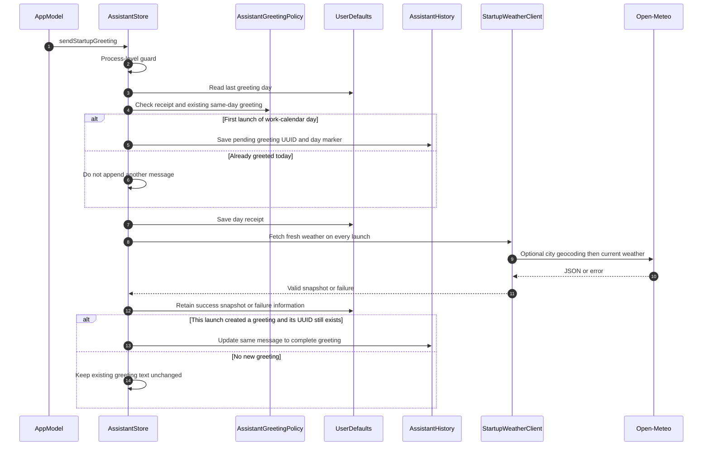

The gate's day key includes the work time-zone identifier and local date. Legacy greetings are recognized from metadata/text; duplicate greetings are hidden in timeline/context projections, not deleted from exportable storage. The app does not automatically issue a new greeting merely by staying open across midnight.

Shanghai aliases use fixed coordinates 31.2304 / 121.4737. Other city names use the geocoding endpoint with one result. Current-weather requests ask for `temperature_2m`, `weather_code`, Unix time and one forecast day. Requests use an 8-second timeout each, bypass URL caches and send `Cache-Control: no-cache`.

Validation requires a finite temperature from −100 to 70°C and an observation time within three hours of fetch time. Weather-code descriptions are mapped locally in both languages; unknown codes produce an unknown-condition label. Failure completes the greeting with unavailable weather, not a fabricated or stale fallback. The initial day receipt is already saved, so a failed first fetch still counts as that day's greeting; later launches refresh weather snapshots silently.

Up to 365 successful snapshots are saved in preferences; new greetings also carry the full snapshot. The owner name/city/date are captured for that launch. Editing the owner name does not retroactively regenerate a saved greeting. DEBUG date clearing removes the matching daily receipt; it does not reset the current process guard or immediately post a replacement.

### 11.3 Interactive checklist contract

`BotChecklist` owns a UUID and `[BotTodo]`. A checklist message's optional payload is the source of truth; there is no global permanent checklist area. Timed reminders remain in `LocalBotState.todos`, independently of message-owned checklist items.

All mutations resolve message ID and item ID in the store before editing. Adding rejects whitespace-only text. Each add/edit/toggle/delete persists history. A completed item is rendered with `Text(...).strikethrough()` because a native-backed `TextField` does not reliably render that SwiftUI decoration; unchecking restores the editable text field. A completed label is therefore not directly editable until unchecked.

The expanded dialog and compact bubble use the same `BotChecklistView` and store. Markdown task-list glyphs in an ordinary model response are read-only and never acquire this behavior automatically.

### 11.4 Daily reporting and next-day carryover extension

Current implementation details are maintained in [the checklist specification](checklist-reports-spec.md). `AssistantHistory.checklists` deduplicates recalled checklist UUIDs, and `checklistItems` supplies the work-calendar day's current task values to reports. Timed reminders remain outside that projection.

The newly appended first daily greeting stores `ChecklistCarryover` before the weather await. `AssistantMessage.displayedContent` appends its localized prompt, so updating weather does not remove the offer. `CarryoverActionsView` appears in both the compact bubble and expanded dialog. The shared store action rejects answered or expired offers, rechecks source IDs and today's lineage, and saves the chosen decision with any newly appended checklist message in one history write. This is not a transaction across UserDefaults or a guarantee against disk-write failures.

Copied tasks receive fresh IDs, retain `originID`, and reset completion/deadline/delivery state. No new system reminder is scheduled. Only the previous calendar day is considered, and an app remaining open across midnight does not automatically create another greeting. The existing daily receipt suppresses a second offer after successful same-day restart.

Report editing extension: diary task names and completion circles now dispatch through `DailyReportStore.editChecklistItem` and the macOS `onChecklistEdit` callback to `AssistantStore.editReportChecklistItem`. The source history is written before publishing the message change and committing the report archive. The report's calendar date and time zone constrain task lookup; updates propagate to recalled copies with the same checklist ID, while independent carried copies retain their own state. Failed source writes reject the report edit. See the checklist specification §9.1 for archive-only editing and cross-store crash limits.

### 11.5 Reminder delivery boundary

Regular reminders reserve their stable event ID in `ReminderLedger` before chat, speech and asynchronous system-notification effects. Notification failure does not retract the chat message. Local task reminders schedule `local.todo.<UUID>` notifications, and global reminder clearing preserves this prefix. Deadline polling marks a todo delivered before appending a chat result; a closed app cannot poll, so overdue undelivered tasks are appended on the next initialization.

The system notification can arrive while the app is closed; the chat record can be appended on reopening. There is no OS-delivery acknowledgement that marks the chat read, and no remote LLM involved in this delivery path.

## 12. Localization, Unread State and Observability

Requirements: R11, R12, R13; constraints: C5, C10.

### 12.1 Language and roles

`AppLanguageStore` persists selection under `appLanguage`; `AppLanguageView` supplies locale. Views observe language changes, and `L10n` loads the paired JSON catalogs in the Swift package.

Local/proactive messages store both `zh-Hans` and `en` text, selected at render/context time. User text remains verbatim. Remote responses are stored as returned and are not retranslated when the UI language changes. Some host/network error strings are currently hard-coded Chinese; the implementation must not be described as having fully bilingual failure messages.

The `proactive` flag is also set for local intent replies through `receive`; it is not a strict event-origin taxonomy. Left/right bubble alignment is determined solely by `role`. A locally generated checkout report is an assistant bubble, not a synthetic user prompt.

### 12.2 Unread semantics

`receive` appends an unread UUID when `panelVisible == false`. Remote replies become unread only after successful nonempty completion while hidden. Interrupted/failed hidden partial replies are not assigned an unread UUID by that completion path.

`setPanelVisible(true)` removes **all** unread UUIDs and persists them before a fade finishes. It does not inspect day filtering, scroll position or individual message visibility. A panel already open and browsing older history also treats newly received proactive content as read. These are existing semantics, not viewport read receipts.

On startup the saved unread set is intersected with loaded message IDs and also primes the typing-ID set. UUID removal after DEBUG clearing similarly reconciles unread/typing IDs.

### 12.3 Diagnostics and actual signals

| Signal | Source and trigger | Limits |
|---|---|---|
| `issue` | Validation, cancellation, request, storage and notification failures | Shared UI string; later operations can replace/clear it |
| `modelIssue` | Catalog refresh/selection state | Independent of a chat request error |
| `AssistantUsage` | Valid usage payload in a chunk | Requires both prompt/completion counts; missing cost is nil, not zero |
| Last usage in panel | `messages.last?.usage` and not streaming | A later local message can hide the previous remote usage line |
| Recorded aggregate | All stored messages with usage | Local observed totals, not account billing or a guaranteed complete audit |
| Latest weather failure | `assistant.latestWeatherFailure` | Last failure only; successful snapshot history is separately bounded |
| Reminder outcomes | Ledger reservation and notification/speech statuses | System acceptance does not guarantee visible OS delivery |

There is no dedicated message-panel analytics SDK, crash correlation ID, performance trace or first-party telemetry event schema in these files. Message UUIDs are the update identity, not analytics events. The credential value must never be added to diagnostics or documentation examples.

## 13. File Inventory

### 13.1 New files in this documentation change

| File | Purpose |
|---|---|
| `docs/message-panel-spec.md` | This as-built reference, diagrams, source excerpts, constraints and verification plan |

### 13.2 Modified files in this documentation change

| File | Change |
|---|---|
| `docs/AI-ASSISTANT.md` | Link this reference and correct superseded overview claims |

### 13.3 Existing implementation files reviewed; no production edits

| File | Why it belongs to the implementation chain |
|---|---|
| `Sources/WorkdayBuddy/App.swift` | App lifetime, child window, visibility, event adapters |
| `Sources/WorkdayBuddy/DesktopPetView.swift` | Compact panel, input, timeline, scroll bridge, bubbles, sheet, checklist |
| `Sources/WorkdayBuddy/Services.swift` | Store, disk/notification effects, credential access and migrations |
| `Sources/WorkdayBuddy/MarkdownMessageView.swift` | Native rich-text block presentation |
| `Sources/WorkdayBuddy/SettingsView.swift` | Model/token/weather settings and separate history/export page |
| `Sources/SharedUI/AppLanguageView.swift` | Observable language and locale wrapper |
| `Sources/WorkdayCore/AIBot.swift` | Pure local decision/action facade and bilingual messages |
| `Sources/WorkdayCore/LocalIntent.swift` | Regex intents and checklist/task/diet payloads |
| `Sources/WorkdayCore/AssistantHistory.swift` | Conversation schema and JSON serializer |
| `Sources/WorkdayCore/AssistantTimeline.swift` | Day selection, date labels and greeting deduplication |
| `Sources/WorkdayCore/AssistantContext.swift` | Group selection, token limits, model catalog and retry predicate |
| `Sources/WorkdayCore/StartupWeather.swift` | Real weather JSON client, validation and localized greeting |
| `Sources/WorkdayCore/MessageMarkdown.swift` | Custom Markdown block parser |
| `Sources/WorkdayCore/PetPanelLayout.swift` | Fixed pet/chat dimensions and coordinate mapping |
| `Sources/WorkdayCore/Localization.swift` | Language resolution, catalog lookup and placeholder substitution |
| `Sources/WorkdayCore/Localization/en.json` and `Sources/WorkdayCore/Localization/zh-Hans.json` | Paired message/UI translations |
| `Sources/WorkdayCore/OpenRouter/OpenRouterClient.swift` | Streaming HTTP ownership and validation |
| `Sources/WorkdayCore/OpenRouter/OpenRouterModels.swift` | Typed/extended request, delta, usage and errors |
| `Sources/WorkdayCore/OpenRouter/SSEParser.swift` | Byte-oriented SSE framing |
| `Configuration/OffWorkNow.entitlements` | Outbound network and user-selected export access in the sandbox |
| `Configuration/PrivacyInfo.xcprivacy` | Declared preferences API use; no implementation of message encryption |
| `Package.swift` and `OffWorkNow.xcodeproj/project.pbxproj` | Shared library/test targets and desktop deployment/build configuration |

## 14. Test Plan and Verification

### 14.1 Evidence levels

Existing committed tests are XCTest cases under `Tests/WorkdayCoreTests`; they do not directly instantiate the AppKit `AssistantStore` or its private views. Historical build/test counts in the guides are prior evidence, not a new test execution caused by this documentation task. Temporary native-window screenshots used during development are not a committed, reproducible UI test suite.

For this documentation-only change, verify source references, fenced blocks, section/requirement links and the runnable example below. Do not label the native manual matrix as automated or re-run paid inference to validate prose.

### 14.2 Complete suggested swift-testing example

This is an additive example for the existing test file, **not an applied test-suite migration**. It uses only current public `WorkdayCore` APIs. The source path exists; the proposed suite below does not yet exist in that file. It combines the high-risk legacy decode contract with the work-time-zone boundary and actual save/load APIs. Run it in an isolated test target with the toolchain's `Testing` support before copying it into the project.

```swift
// Tests/WorkdayCoreTests/AssistantTimelineTests.swift (CHANGED: proposed additive example; not applied)
import Foundation
import Testing
import WorkdayCore

@Suite("Message panel storage contract")
struct MessagePanelStorageContract {
    @Test
    func legacyHistoryDoesNotLeakAcrossTheWorkday() throws {
        let data = Data(#"""
        [
          {"id":"11111111-1111-1111-1111-111111111111","date":"2026-10-15T15:59:00Z","role":"user","content":"old user","complete":true},
          {"id":"22222222-2222-2222-2222-222222222222","date":"2026-10-15T15:59:30Z","role":"assistant","content":"old reply","complete":true},
          {"id":"33333333-3333-3333-3333-333333333333","date":"2026-10-15T16:01:00Z","role":"user","content":"today user","complete":true},
          {"id":"44444444-4444-4444-4444-444444444444","date":"2026-10-15T16:01:01Z","role":"assistant","content":"today reply","complete":true}
        ]
        """#.utf8)
        let decoder = JSONDecoder()
        decoder.dateDecodingStrategy = .iso8601
        let history = try decoder.decode([AssistantMessage].self, from: data)
        #expect(history.allSatisfy { $0.weather == nil && $0.checklist == nil })

        var calendar = Calendar(identifier: .gregorian)
        calendar.timeZone = try #require(TimeZone(identifier: "Asia/Shanghai"))
        let now = try #require(ISO8601DateFormatter().date(from: "2026-10-15T16:02:00Z"))
        let context = try AssistantContext.build(
            history: history, system: "system", current: "next",
            now: now, calendar: calendar
        )
        let strings = context.compactMap { message -> String? in
            guard case .string(let value) = message.content else { return nil }
            return value
        }
        #expect(strings == ["system", "today user", "today reply", "next"])

        let directory = FileManager.default.temporaryDirectory
            .appendingPathComponent(UUID().uuidString)
        defer { try? FileManager.default.removeItem(at: directory) }
        let url = directory.appendingPathComponent("history.json")
        try AssistantHistory.save(history, to: url)
        #expect(try AssistantHistory.load(from: url) == history)
    }
}
```

### 14.3 Existing coverage and gaps

| Requirement | Existing committed test source | What is actually covered | Remaining validation |
|---|---|---|---|
| R1–R2 | `Tests/WorkdayCoreTests/MessagePresentationTests.swift` | Four-direction frame math, clamping, saved placement compatibility; older combined geometry helpers | Real native frames, fade race, Reduce Motion, drag and multiple monitors |
| R3 | `Tests/WorkdayCoreTests/LocalIntentTests.swift` | Supported checklist phrases, diet routing, past/invalid reminder times, basic task Codable | Store side effects, permission denial, deadlines, no-key local send |
| R4 | `Tests/WorkdayCoreTests/OpenRouterTests.swift`, `Tests/WorkdayCoreTests/OpenRouterErrorTests.swift` | Encoding, byte boundaries, DONE, EOF, cancellation while waiting, HTTP/API errors, retry eligibility | Store fallback selection, partial-after-cancel, no-text usage contamination, final-chunk race |
| R5–R6 | `Tests/WorkdayCoreTests/AssistantTimelineTests.swift`, `Tests/WorkdayCoreTests/AssistantContextTests.swift` | Date grouping, absent days, time-zone boundary, today-only context, six groups, budget and incomplete exclusion | Native rubber-band load, anchor retention, same-day manual scroll and midnight fallback |
| R6 | `Tests/WorkdayCoreTests/AssistantCatalogTests.swift` | Catalog filters/restore, provider/model capacity, reasoning parameter metadata | Live provider availability is not a unit-test guarantee |
| R7 | `Tests/WorkdayCoreTests/MessagePresentationTests.swift` | Markdown headings, lines, quotes, code fences, tables and inline formatting | Prefix timing, long-day performance, native horizontal scrolling |
| R8–R9 | `Tests/WorkdayCoreTests/AssistantTimelineTests.swift`, `Tests/WorkdayCoreTests/LocalIntentTests.swift` | Independent checklist serialization and context text | Per-message footer measurement/UUID selection, sheet, copy, real check/edit/delete and strikethrough |
| R10 | `Tests/WorkdayCoreTests/StartupWeatherTests.swift`, `Tests/WorkdayCoreTests/AssistantTimelineTests.swift` | URLProtocol cache-bypass requests, response validation, bilingual content, daily receipt and legacy dedup | Host relaunch integration, failed first request, interrupted greeting, non-Shanghai lookup |
| R11 | No dedicated committed store test | UUID persistence code was reviewed | Hidden success/partial, open-while-browsing, filtered older unread |
| R12 | `Tests/WorkdayCoreTests/LocalizationTests.swift` | Catalog parity, placeholders, language resolution and proactive history language switching | Hard-coded errors, existing system notification language, long English layouts |
| R13–R14 | `Tests/WorkdayCoreTests/AssistantHistoryTests.swift` | Unicode/partial round trip and corrupt-input throwing | Host overwrite behavior, migration crash consistency, export dialog and credential exclusion audit |
| Checkout/reminder source | `Tests/WorkdayCoreTests/AIBotTests.swift` | Ordered local checkout actions, bilingual reports, reminder policy and no duplicate domain event | Native channels, source-to-message identity and OS notification acceptance |

### 14.4 Numbered native QA

1. Open/close each of four placements, rapidly toggle during both fade directions, drag the pet, and change monitors/scale. Assert pet frame stability and correct level/Spaces behavior.
2. Repeat with Reduce Motion, light/dark appearance, VoiceOver and keyboard-only operation; check icon-only expansion has an accessible name.
3. Exercise Return, keypad Enter, Shift+Return, Chinese IME candidate confirmation, multiline paste, 88-point input cap and rejected-send draft retention.
4. Use no saved API key: supported local checklist/diet/reminder commands must work; an unknown prompt must retain the draft and point to Settings. There is no account login/guest layer; missing-key mode is the relevant logged-out equivalent.
5. Create two distinct checklists. Edit, check, uncheck, delete and relaunch; verify message/item identity, independent state and visible strikethrough. Repeat edits from an expanded sheet.
6. Send remote text with an explicitly approved test credential. Stop after partial content, close while streaming and reopen; compare Settings and compact panel. Do not use a paid/live call as a default docs check.
7. Simulate HTTP429/502/503 before any text and after partial text. Verify only the former eligible free route retries, at most once, with no paid switch and correct actual model/usage.
8. Seed today plus two prior nonempty days and an empty date. Pull/button-load each, check one header per older day, preserved anchor and no bottom-follow while history browsing. Reopen to return to today.
9. Scroll upward within today's messages during a stream; record the existing auto-follow behavior rather than asserting an unimplemented user-scroll pause. Test midnight/time-zone changes and a cross-midnight fallback.
10. Render two long messages and one short message, including a long code fence and a tall checklist. Only each long bubble gets its own lower-right icon; each opens its own UUID. Verify the complete body, horizontal content, Copy All and Escape with no additional network request.
11. Launch twice on the same local day: one greeting, two fresh weather fetches/snapshots. Launch on the next day. Test offline/invalid weather: unavailable copy, no fabricated values and no duplicate greeting on relaunch.
12. Switch App language while history, sheet and Settings are open. Local content should switch; user/cloud text should remain verbatim. Already scheduled OS notification copy is not automatically retranslated by this path.
13. Send a proactive message while hidden, then open: badge clears. Repeat with older unread records filtered from today's view and with an open panel browsing history; record current acknowledgement semantics.
14. Open the Settings history subpage, return, export to a user-selected location and inspect structured checklist/weather payloads. Use only synthetic data. Confirm no credential field is exported.
15. Inject a malformed synthetic history copy in an isolated test store. Verify the current load error and demonstrate overwrite risk without touching a user's real data; do not treat a throwing core decoder as end-to-end recovery protection.

## 15. Rollout and Feature Gating

### 15.1 Existing gates

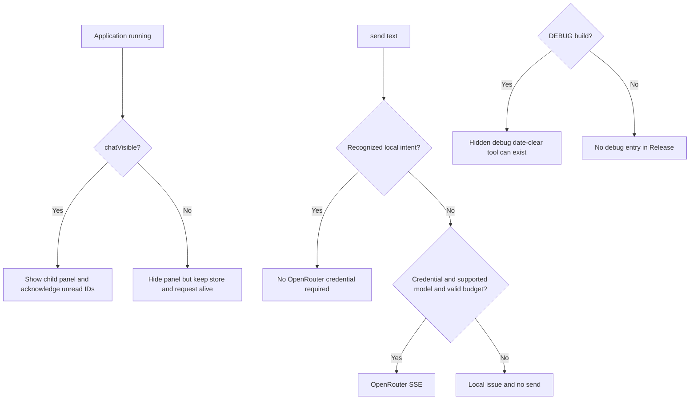

There is no dedicated client kill switch or remote experiment bucketing for the message panel. `chatVisible` is visibility state, not an execution/network kill switch. `petEnabled` is also not a universal chat disable: an explicitly visible chat can keep the pet host window available. Notification permission gates OS delivery, not local chat results. DEBUG gating is compile-time and independent of these runtime states.

### 15.2 Delivery order and future compatibility constraints

This change ships only Markdown documentation; no backend rollout, credential operation, archive, signing or DMG rebuild is required.

| Phase | Content | Reason / constraint |
|---|---|---|
| 1 — this change | Publish this spec and update the overview link/obsolete claims | Establish one source-backed implementation reference |
| 2 — only if separately approved | Decide Q1 and add recovery/migration tests before evolving required stored fields | A bad item currently prevents all history from loading and may be overwritten |
| 3 — only if separately approved | Implement additive optional payload support and decoder/storage compatibility | Must reach clients before a future payload producer can emit incompatible data |
| 4 — only if separately approved | Add UI/store integration tests for new behavior before enabling it | Current geometry/domain tests do not prove window, read-receipt or migration behavior |

Do not roll back to a binary that rewrites messages while discarding newly introduced fields without a backup/migration decision. Older synthesized decoders may ignore optional unknown keys and later overwrite their data. There is no server bucketing mechanism to protect those on-disk writes.

## 16. Open Questions and Ownership

No open question blocks publishing this as-built document. “Blocking” below means before the named future change or stronger product guarantee; none of these fixes is silently included in this documentation task.

| ID | Question / current evidence | Owner | Blocking |
|---|---|---|---|
| Q1 | Should corrupt history be backed up, isolated per item, or put into a read-only recovery state before another receive/send? Current init can overwrite an unreadable conversation on a later save. | macOS client + data owner | Yes before a storage/schema migration; §5 and C1/C7 |
| Q2 | What flush cadence, maximum history size and UI latency budget should replace full main-actor array writes if history grows? Current UI day paging does not bound disk/memory work; stream buffering is not explicitly bounded. | macOS client + performance owner | No for current documentation; decide before performance/storage refactor |
| Q3 | Does “read” mean opening the panel or each message entering the viewport, including older filtered dates and interrupted remote replies? Current implementation acknowledges all on open. | Product + macOS client | No; required before promising viewport read receipts |
| Q4 | Should same-day local diet/salary/weather/checklist data be excluded from remote context unless explicitly requested? Current shared context permits these complete proactive messages. | Product + privacy owner + client | No; required before claiming local records never leave the device |
| Q5 | Should `AIBotMessage.id/date` be preserved in persisted chat for idempotency and event-time grouping? Current adapters pass only translations; regular reminder dedup lives in a separate ledger. | AIBot owner + macOS client | No; required before adding replay/import or cross-adapter synchronization |
| Q6 | At screen edges should chat flip sides instead of clamping over the pet, and should expansion size follow the actual chat monitor rather than `NSScreen.main`? Current behavior is clamp/main-screen sizing. | Product + desktop UI owner | No; native multimonitor acceptance needed |
| Q7 | Should any manual upward scroll pause bottom following, or only explicit older-day browsing? Current flag changes only during load-earlier/back-to-today transitions. | Product + desktop UI owner | No; required before changing follow-scroll UX |
| Q8 | Should interrupted/failed first weather greetings be updated on a later same-day launch? Current receipt prevents a second greeting and later fetches only update snapshots. | Product + AIBot owner | No; current once-per-day contract is explicit |
| Q9 | Should length/filter finish reasons affect completeness, and should fallback clear prior attempt usage before another provider responds? Current completion checks nonempty text/DONE and retains message fields during fallback. | Assistant/transport owner | No; required before stronger completion/billing claims |
| Q10 | Which committed UI/store test target and minimum-toolchain policy should own the missing native/integration cases? The sample in §14 is not an XCTest migration and temporary render harnesses are not shipped tests. | Client test owner | No; before automated UI guarantees |
| Q11 | Should all error strings and scheduled task-notification titles react to language changes? Current canned messages are bilingual, but several host/transport errors are Chinese and scheduled native content is not rescheduled here on language change. | Localization owner + client | No; before claiming full bilingual failure/notification coverage |

### Documentation verification record — 2026-10-16

- All 16 numbered sections, 38 fence delimiters, relative file links and 37 explicitly formatted source/test/configuration paths passed structural/existence checks.
- Every `UNCHANGED` Swift excerpt was matched verbatim against its referenced source file.
- The §14 Swift Testing example was extracted unchanged into an isolated temporary package using this repository's `WorkdayCore`; `swift test` passed **1 test in 1 suite**. This did not add tests to the repository or rerun its application test suite.
- `git diff --check` passed. Mermaid blocks were source-reviewed; no Mermaid rendering engine was run.
- Only this document and its overview link/corrections changed. No application build, live model request or runtime data modification was performed.
